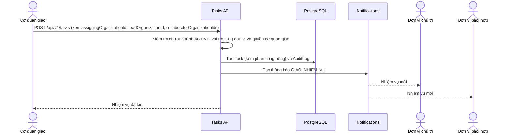
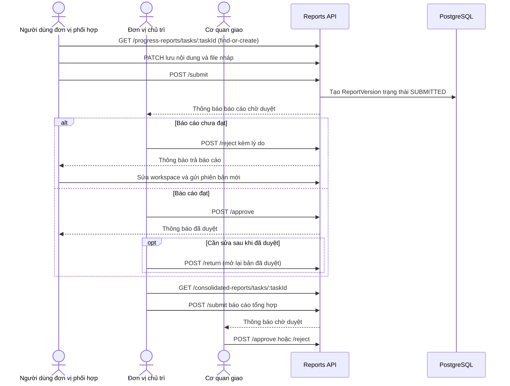
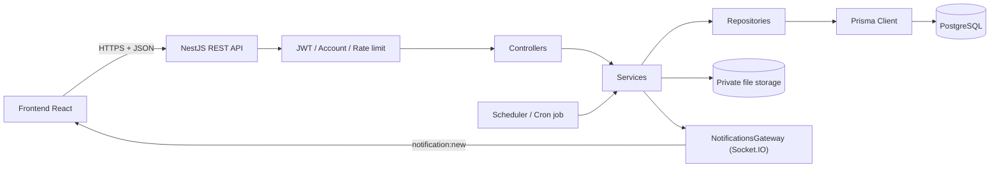
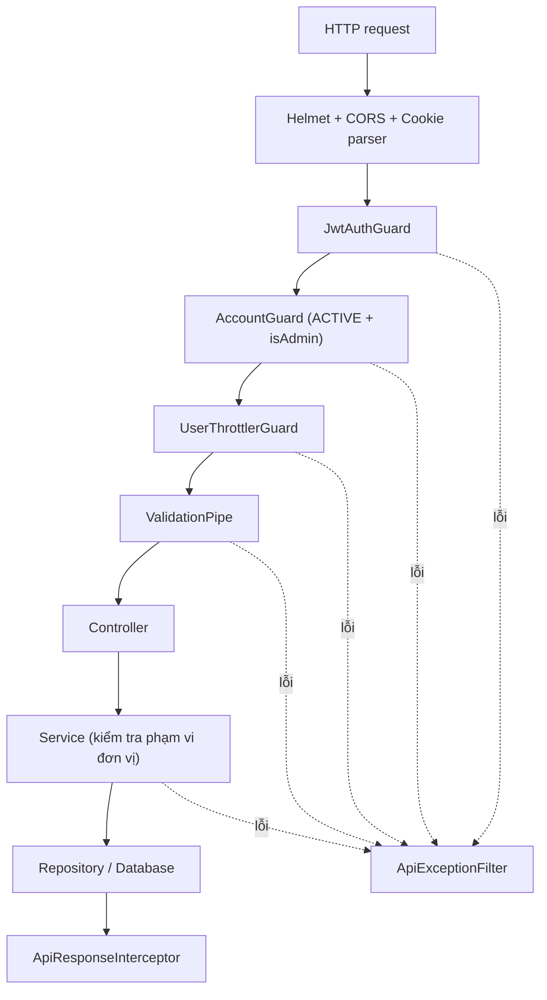
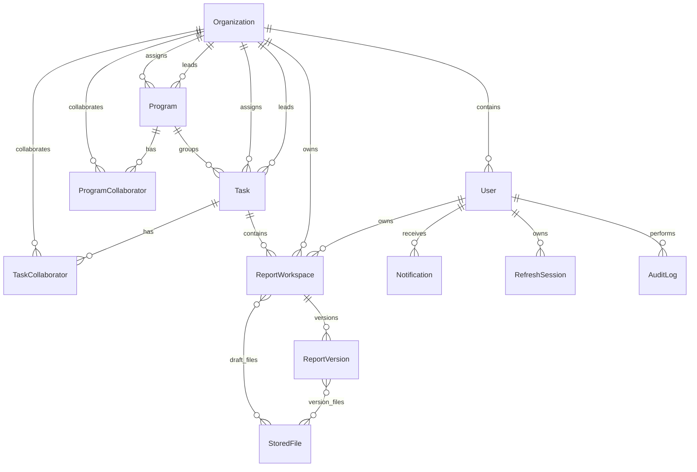

# Kiến trúc Backend hệ thống giao nhiệm vụ

Tài liệu này mô tả **đúng trạng thái code Backend hiện tại** trong thư mục
`be`. Đối tượng đọc là developer mới, tester, BA hoặc người cần tra cứu một API
dùng để làm gì trước khi đọc mã nguồn.

## 1. Backend giải quyết bài toán gì?

Backend phục vụ quy trình giao nhiệm vụ giữa các đơn vị:

1. Admin khai báo **Chương trình**, gắn sẵn cơ quan giao, đơn vị chủ trì và các
   đơn vị phối hợp.
2. Người tạo nhiệm vụ chọn một chương trình và tự khai báo cơ quan giao, đơn vị
   chủ trì, đơn vị phối hợp cho riêng nhiệm vụ đó — form **tự điền sẵn** ba
   trường này từ phân công của chương trình, nhưng người dùng có thể sửa lại
   trước khi submit.
3. Từng người dùng thuộc đơn vị phối hợp lập báo cáo tiến độ của riêng mình và
   gửi cho đơn vị chủ trì.
4. Đơn vị chủ trì duyệt hoặc trả báo cáo để người gửi sửa và gửi lại.
5. Đơn vị chủ trì lập báo cáo tổng hợp cấp nhiệm vụ.
6. Cơ quan giao hoặc Admin duyệt báo cáo tổng hợp.
7. Cơ quan giao đánh dấu hoàn thành nhiệm vụ đột xuất hoặc đóng nhiệm vụ định kỳ.

Ngoài nghiệp vụ chính, Backend còn quản lý đăng nhập, người dùng, đơn vị,
chương trình, file báo cáo, thông báo trong ứng dụng, dashboard và nhật ký audit.

## 2. Các khái niệm nghiệp vụ

| Khái niệm | Ý nghĩa trong hệ thống |
|---|---|
| Cơ quan giao | Đơn vị có `isAssigningAuthority = true`; trên mỗi nhiệm vụ là `Task.assigningOrganizationId`. |
| Đơn vị chủ trì | `Task.leadOrganizationId`; duyệt báo cáo tiến độ và lập báo cáo tổng hợp. |
| Đơn vị phối hợp | Đơn vị trong `TaskCollaborator`; người dùng của đơn vị này gửi báo cáo tiến độ. |
| Đơn vị thực hiện | Đơn vị có `isExecutingUnit = true`; điều kiện để được chọn làm chủ trì hoặc phối hợp, trên cả `Program` lẫn `Task`. |
| Chương trình | `Program` — Danh mục/Nghị quyết; vẫn giữ ba cột phân công riêng, nhưng nay chỉ dùng làm **giá trị mặc định** mà form tạo nhiệm vụ tự điền. |
| Nhiệm vụ | `Task` — thuộc đúng một chương trình và **tự giữ phân công đơn vị của chính nó** (`assigningOrganizationId`, `leadOrganizationId`, `collaborators`), độc lập với phân công của chương trình cha. |
| Nhiệm vụ đột xuất | `DOT_XUAT`, có `dueAt`; Backend tính 5 trạng thái thời hạn. |
| Nhiệm vụ định kỳ | `DINH_KY`, có `startAt`; kết thúc bằng thao tác đóng kèm lý do. |
| Report workspace | Bản nháp hiện tại. Tiến độ: một bản cho **mỗi người dùng phối hợp**. Tổng hợp: một bản cho đơn vị chủ trì. |
| Report version | Bản chụp bất biến được tạo mỗi lần người dùng gửi báo cáo. |
| Audit log | Lịch sử ai đã làm gì, lúc nào, trên dữ liệu nào. |

> **Quan trọng.** Bộ ba trách nhiệm (`assigningOrganizationId`,
> `leadOrganizationId`, `collaboratorOrganizationIds`) nằm trên **`Task`**,
> không còn nằm trên `Program`. `Program` vẫn giữ đúng ba cột này, nhưng chỉ
> đóng vai trò **giá trị mặc định** mà form tạo nhiệm vụ tự điền sẵn từ chương
> trình đã chọn — người dùng có thể sửa lại trước khi submit. Mọi kiểm tra
> phạm vi trong service đều đọc trực tiếp `task.assigningOrganizationId`,
> `task.leadOrganizationId`, `task.collaborators`, không còn đi qua
> `task.program.*`. `CreateTaskDto` (`z.strictObject`) nay **bắt buộc** phải có
> cả ba trường `assigningOrganizationId`, `leadOrganizationId` và
> `collaboratorOrganizationIds` (mảng thứ ba tối thiểu 1 phần tử); thiếu một
> trong ba sẽ bị từ chối 400.
>
> Toàn bộ kiểm tra phạm vi liên quan đến nhiệm vụ — danh sách nhiệm vụ, review
> báo cáo, authorization file upload/download, dashboard và thông báo
> sắp/quá hạn — đều đọc phân công đơn vị của chính nhiệm vụ đó, không còn đọc
> qua chương trình cha.

### Mô hình phân quyền

Không còn RBAC theo nhóm quyền. Schema hiện **không có** model `PermissionGroup`
hay `Permission`, và codebase **không có** decorator `@Permissions`. Phân quyền
gồm đúng ba mức:

| Mức | Cách xác định | Áp dụng cho |
|---|---|---|
| Public | `@Public()` | Login, refresh, logout, health. |
| Đăng nhập | Mặc định: `JwtAuthGuard` + `AccountGuard` (tài khoản phải `ACTIVE`) | Toàn bộ API nghiệp vụ. |
| Admin | `@AdminOnly()` | `/system/*` (trừ health) và `/audit-logs`. |

`AccountGuard` nạp lại user từ database mỗi request, gán
`request.user.organizationId` và tính
`request.user.isAdmin = user.id === 1`
(`src/guards/account.guard.ts:32`).

> **Cảnh báo bảo mật.** Quyền admin đang gắn cứng vào `user.id === 1`. Không có
> cách cấp quyền admin cho tài khoản thứ hai, và xóa/tạo lại user id 1 sẽ đổi
> chủ sở hữu quyền admin. Đây là mô tả hiện trạng, không phải thiết kế khuyến
> nghị.

Ngoài ba mức trên, mọi giới hạn còn lại là **kiểm tra phạm vi đơn vị trong
service**, ví dụ chỉ cơ quan giao của nhiệm vụ mới được sửa nhiệm vụ đó, chỉ
đơn vị chủ trì mới được duyệt báo cáo tiến độ.

## 3. Luồng nghiệp vụ chính

### 3.1 Giao nhiệm vụ



Điều kiện quan trọng:

- Người tạo phải là Admin, hoặc thuộc đúng `assigningOrganizationId` được chọn
  cho nhiệm vụ (không phải đơn vị của chương trình cha). Lỗi
  `TASK_CAN_ONLY_BE_ASSIGNED_BY_THE_CURRENT_ORGANIZATION` (`IEM17`).
- Cơ quan giao phải có `isAssigningAuthority`; đơn vị chủ trì và mọi đơn vị
  phối hợp phải `ACTIVE` và có `isExecutingUnit`. Một đơn vị có thể giữ nhiều
  vai trò trên cùng một nhiệm vụ (ví dụ vừa chủ trì vừa phối hợp).
- Danh sách đơn vị phối hợp không được trùng và phải có ít nhất 1 đơn vị.
- Chương trình phải đang `ACTIVE`.
- Mã nhiệm vụ `code` là duy nhất toàn hệ thống.
- `startAt` không được sau `dueAt`.
- Không đổi loại nhiệm vụ (`type`) sau khi tạo.
- Sau khi nhiệm vụ đã phát sinh báo cáo, hoặc đã đóng/hoàn thành, không được
  đổi `programId`, `assigningOrganizationId`, `leadOrganizationId` hay
  `collaboratorOrganizationIds` nữa — service ném lỗi
  `TASK_ASSIGNMENT_CANNOT_BE_CHANGED` (`IEM08`).

### 3.2 Báo cáo tiến độ và báo cáo tổng hợp



Điểm cần nắm:

- Workspace được định danh bằng **(taskId, kind, ownerOrganizationId,
  ownerUserId)**. Không có chiều "kỳ báo cáo".
- Endpoint mở workspace là `GET` nhưng có **tác dụng phụ tạo dữ liệu**
  (find-or-create).
- Báo cáo tiến độ là **theo từng người dùng** (`ownerUserId`), không phải theo
  đơn vị. Báo cáo tổng hợp có `ownerUserId = null`, thuộc về đơn vị chủ trì.
- Admin có thể truyền `?ownerUserId=` để mở workspace của người khác; người dùng
  thường luôn bị ép về chính mình.
- `ReportWorkspace` giữ bản nháp hiện tại; mỗi lần submit tạo một
  `ReportVersion` mới để giữ lịch sử. Bản `SUBMITTED` bị khóa sửa; bản
  `REJECTED` được mở lại. Bản `APPROVED` chỉ mở lại được qua `/return`.

### 3.3 Kết thúc nhiệm vụ

Chỉ còn **một** thao tác kết thúc có route:

| Thao tác | Điều kiện |
|---|---|
| `DELETE /tasks/:id` | Chưa phát sinh báo cáo đã gửi. Xóa mềm bằng `deletedAt`. Yêu cầu Admin hoặc cơ quan giao. |

`TasksService.close()` (đóng nhiệm vụ định kỳ kèm lý do) và
`TasksService.complete()` (hoàn thành nhiệm vụ đột xuất) còn trong code nhưng
**không có route**, nên không gọi được từ client. Trường `closedAt`,
`closeReason`, `completedAt` vẫn tồn tại trên `Task` và vẫn được trả về trong
response, chỉ là hiện không có đường nào ghi vào chúng qua API.

Năm trạng thái thời hạn của nhiệm vụ đột xuất
(`src/utils/task-deadline-status.ts`):

| Trạng thái | Điều kiện |
|---|---|
| `DANG_THUC_HIEN` | Chưa hoàn thành và còn trên 5 ngày. |
| `SAP_DEN_HAN` | Chưa hoàn thành và hạn nằm trong 5 ngày tới. |
| `QUA_HAN` | Chưa hoàn thành và thời điểm hiện tại đã qua hạn. |
| `HOAN_THANH_DUNG_HAN` | `completedAt <= dueAt`. |
| `HOAN_THANH_QUA_HAN` | `completedAt > dueAt`. |

Năm trạng thái trên được cron job tính lại hằng ngày và tính lúc đọc; không có
thao tác thủ công nào của client đặt `completedAt`.

## 4. Kiến trúc tổng thể



Backend là một ứng dụng NestJS duy nhất, không chia microservice:

```text
Controller → Service → Repository → PrismaService → PostgreSQL
```

| Tầng | Trách nhiệm |
|---|---|
| Controller | Khai báo URL, HTTP method, DTO và chuyển request vào service. |
| DTO | Kiểm tra kiểu, độ dài và định dạng dữ liệu đầu vào (`zod`, strict object). |
| Guard | Xác thực JWT, chặn tài khoản không `ACTIVE`, giới hạn request, chặn CSRF. |
| Service | Chứa luật nghiệp vụ và **toàn bộ kiểm tra phạm vi đơn vị**. |
| Repository | Truy vấn database, transaction, row lock và ghi audit. |
| PrismaService | Kết nối Prisma với PostgreSQL qua driver adapter `pg`. |
| Job | Cron cập nhật `deadlineStatus` của nhiệm vụ đột xuất. |

### Luồng của một request



## 5. Cấu trúc thư mục

```text
be/
├── prisma/
│   ├── schema.prisma          # Mô hình dữ liệu
│   ├── migrations/            # Lịch sử thay đổi database
│   └── seed/                  # Đơn vị, admin, chương trình và nhiệm vụ mẫu
├── src/
│   ├── config/                # Cấu hình HTTP và biến môi trường
│   ├── constants/             # TTL token, danh mục action audit
│   ├── controllers/           # Danh sách REST endpoint
│   ├── decorators/            # @CurrentUser, @AdminOnly, @Public, @ResponseMessage
│   ├── dtos/                  # Kiểm tra request đầu vào
│   ├── filters/               # Chuẩn hóa lỗi API
│   ├── gateways/              # Socket.IO gateway đẩy thông báo realtime
│   ├── guards/                # JWT, account, CSRF, rate limit
│   ├── interceptors/          # Chuẩn hóa response thành envelope
│   ├── jobs/                  # Cron cập nhật deadlineStatus
│   ├── modules/               # Đăng ký Schedule, Throttler, Jwt
│   ├── prisma/                # Prisma client và PrismaService
│   ├── repositories/          # Truy cập DB và transaction
│   ├── services/              # Luật nghiệp vụ
│   ├── types/                 # Kiểu dữ liệu nội bộ
│   └── utils/                 # File tài liệu/ảnh, trạng thái hạn, request metadata
├── storage/                   # File private nếu không cấu hình STORAGE_PATH
└── test/                      # Integration/E2E với PostgreSQL test
```

## 6. Mô hình dữ liệu



### Bảng dữ liệu

| Model | Dùng để làm gì? |
|---|---|
| `Organization` | Đơn vị, kèm cờ `isAssigningAuthority` và `isExecutingUnit`. |
| `User` | Tài khoản đăng nhập, thuộc đúng một đơn vị. |
| `Program` | Chương trình/Nghị quyết; **giữ phân công cơ quan giao và đơn vị chủ trì**. |
| `ProgramCollaborator` | Các đơn vị phối hợp của một chương trình. |
| `Task` | Nhiệm vụ thuộc một chương trình; tự giữ phân công đơn vị riêng (`assigningOrganizationId`, `leadOrganizationId`) và trạng thái vòng đời. |
| `TaskCollaborator` | Các đơn vị phối hợp của một nhiệm vụ; độc lập với `ProgramCollaborator` của chương trình cha. |
| `ReportWorkspace` | Bản nháp hiện tại của một người dùng (tiến độ) hoặc đơn vị chủ trì (tổng hợp). |
| `ReportVersion` | Phiên bản bất biến được lưu khi submit. |
| `StoredFile` | Metadata của file private trên ổ đĩa. |
| `DraftAttachment`, `VersionAttachment` | Liên kết file với bản nháp và với phiên bản đã gửi. |
| `Notification` | Thông báo của từng người dùng, khóa chống trùng `(recipientId, eventKey)`. |
| `AuditLog` | Nhật ký nghiệp vụ và bảo mật. |
| `RefreshSession` | Phiên refresh token có thể thu hồi/rotate. |

Loại thông báo (`NotificationType`): `GIAO_NHIEM_VU`, `DONG_NHIEM_VU`,
`GUI_BAO_CAO`, `DUYET_BAO_CAO`, `TRA_BAO_CAO`, `MO_KY_BAO_CAO`, `QUA_HAN`,
`SAP_DEN_HAN`.

## 7. Quy ước chung của API

- Base URL: `http://localhost:3030/api/v1`
- Swagger UI: `http://localhost:3030/api/docs`
- API bảo vệ dùng header `Authorization: Bearer <accessToken>`.
- Request JSON bị từ chối nếu có field không được DTO khai báo.
- Phân trang mặc định `page=1`, `limit=20`, tối đa `limit=100`.

Response thành công:

```json
{
  "statusCode": 200,
  "data": {}
}
```

Response phân trang:

```json
{
  "statusCode": 200,
  "data": [],
  "meta": { "page": 1, "limit": 20, "total": 0, "totalPages": 0 }
}
```

Response lỗi:

```json
{
  "statusCode": 400,
  "errorCode": "VALIDATION_ERROR",
  "message": "Nội dung lỗi",
  "requestId": "uuid-hoac-x-request-id"
}
```

## 8. Danh mục API

Cột "Quyền" ghi `Đăng nhập` nghĩa là chỉ cần token hợp lệ ở tầng guard; giới hạn
thực tế nằm ở kiểm tra phạm vi đơn vị trong service, ghi rõ ở cột cuối.

### 8.1 Authentication

| Method | Endpoint | Dùng để làm gì? | Quyền |
|---|---|---|---|
| `POST` | `/auth/login` | Đăng nhập, trả access token và đặt refresh/CSRF cookie. | Public |
| `POST` | `/auth/refresh` | Rotate refresh session và cấp access token mới. | Public + CSRF |
| `POST` | `/auth/logout` | Thu hồi refresh session và xóa cookie. | Public + CSRF |
| `GET` | `/auth/profile` | Lấy user và đơn vị hiện hành. | Đăng nhập |
| `PATCH` | `/auth/change-password` | Đổi mật khẩu và thu hồi các phiên cũ. | Đăng nhập |

Cookie refresh giới hạn ở path `/api/v1/auth`.

### 8.2 Tasks

| Method | Endpoint | Dùng để làm gì? | Phạm vi trong service |
|---|---|---|---|
| `GET` | `/tasks` | Danh sách nhiệm vụ người dùng được phép thấy. | Admin xem toàn hệ thống; còn lại theo đơn vị. |
| `POST` | `/tasks` | Tạo nhiệm vụ thuộc một chương trình, tự khai báo cơ quan giao/chủ trì/phối hợp riêng. | Admin hoặc đơn vị được chọn làm `assigningOrganizationId`. |
| `GET` | `/tasks/lookups/programs` | Chương trình `ACTIVE` kèm phân công đơn vị. | Đăng nhập |
| `GET` | `/tasks/lookups/organizations` | Đơn vị `ACTIVE` kèm hai cờ vai trò. | Đăng nhập |
| `GET` | `/tasks/:id` | Chi tiết nhiệm vụ. | Theo phạm vi đơn vị. |
| `PATCH` | `/tasks/:id` | Sửa nhiệm vụ. Không đổi được `type`. | Admin hoặc cơ quan giao. |
| `DELETE` | `/tasks/:id` | Xóa mềm nhiệm vụ. | Admin hoặc cơ quan giao; chặn nếu đã có báo cáo gửi. |
| `GET` | `/tasks/:taskId/report-workspaces` | Liệt kê workspace báo cáo của nhiệm vụ. | Admin hoặc đơn vị chủ trì. |

> **Không có endpoint đóng/hoàn thành nhiệm vụ.** `TasksService.close()` và
> `TasksService.complete()` vẫn tồn tại nhưng **không được gắn route nào** trong
> `TasksController`, nên hiện là code chết chỉ chạy được từ unit test. Client gọi
> `POST /tasks/:id/close` hoặc `/complete` sẽ nhận 404.

Ví dụ tạo nhiệm vụ đột xuất — **bắt buộc** kèm đủ ba trường đơn vị:

```json
{
  "code": "NV-001",
  "name": "Kiểm tra an toàn hệ thống",
  "description": "Kiểm tra và lập báo cáo",
  "expectedOutput": "Báo cáo kết quả",
  "type": "DOT_XUAT",
  "programId": 1,
  "assigningOrganizationId": 1,
  "leadOrganizationId": 2,
  "collaboratorOrganizationIds": [3, 4],
  "dueAt": "2026-08-31T17:00:00.000Z"
}
```

Nhiệm vụ định kỳ dùng `"type": "DINH_KY"` và `startAt` thay cho `dueAt`. Không
có trường `frequency`, và không có ràng buộc ngày bắt đầu phải là ngày 15.

### 8.3 Progress reports

Dành cho người dùng thuộc đơn vị phối hợp lập báo cáo và đơn vị chủ trì review.
`:id` là `ReportWorkspace.id`.

| Method | Endpoint | Dùng để làm gì? | Phạm vi trong service |
|---|---|---|---|
| `GET` | `/progress-reports/tasks/:taskId` | Tìm hoặc tạo workspace tiến độ. Query `ownerUserId` chỉ Admin dùng được. | Đơn vị của người báo cáo phải là phối hợp. |
| `GET` | `/progress-reports/:id` | Xem workspace tiến độ. | Chủ workspace, chủ trì, cơ quan giao hoặc Admin. |
| `PATCH` | `/progress-reports/:id` | Lưu nội dung nháp. | Chủ workspace. |
| `POST` | `/progress-reports/:id/submit` | Tạo phiên bản và gửi chủ trì duyệt. | Chủ workspace. |
| `POST` | `/progress-reports/:id/approve` | Duyệt phiên bản mới nhất. | Đơn vị chủ trì hoặc Admin. |
| `POST` | `/progress-reports/:id/reject` | Trả báo cáo kèm lý do. | Đơn vị chủ trì hoặc Admin. |
| `POST` | `/progress-reports/:id/return` | Mở lại báo cáo đã duyệt để sửa. | Đơn vị chủ trì hoặc Admin. |
| `POST` | `/progress-reports/:id/files` | Upload file vào bản nháp (multipart field `file`). | Chủ workspace. |
| `DELETE` | `/progress-reports/:id/files/:fileId` | Xóa file khỏi bản nháp. | Chủ workspace. |
| `GET` | `/progress-reports/:id/files/:fileId/download` | Tải file private của workspace. | Theo phạm vi đọc. |

### 8.4 Consolidated reports

Cấu trúc giống progress report nhưng dành cho đơn vị chủ trì. Workspace tổng hợp
gắn với **nhiệm vụ**, có `ownerUserId = null`.

| Method | Endpoint | Dùng để làm gì? | Phạm vi trong service |
|---|---|---|---|
| `GET` | `/consolidated-reports/tasks/:taskId` | Tìm hoặc tạo workspace tổng hợp. | Đơn vị chủ trì hoặc Admin. |
| `GET` | `/consolidated-reports/:id` | Xem workspace tổng hợp. | Theo phạm vi đọc. |
| `PATCH` | `/consolidated-reports/:id` | Lưu nội dung tổng hợp nháp. | Chủ workspace. |
| `POST` | `/consolidated-reports/:id/submit` | Gửi báo cáo tổng hợp cho cơ quan giao. | Chủ workspace. |
| `POST` | `/consolidated-reports/:id/approve` | Duyệt báo cáo tổng hợp. | Cơ quan giao hoặc Admin. |
| `POST` | `/consolidated-reports/:id/reject` | Trả báo cáo tổng hợp kèm lý do. | Cơ quan giao hoặc Admin. |
| `POST` | `/consolidated-reports/:id/return` | Mở lại báo cáo tổng hợp đã duyệt. | Cơ quan giao hoặc Admin. |
| `POST` | `/consolidated-reports/:id/files` | Upload file vào bản nháp. | Chủ workspace. |
| `DELETE` | `/consolidated-reports/:id/files/:fileId` | Xóa file nháp. | Chủ workspace. |
| `GET` | `/consolidated-reports/:id/files/:fileId/download` | Tải file private của workspace. | Theo phạm vi đọc. |

### 8.5 Report history

| Method | Endpoint | Dùng để làm gì? | Quyền |
|---|---|---|---|
| `GET` | `/report-history` | Tra cứu các phiên bản báo cáo đã submit. | Đăng nhập, lọc theo phạm vi. |
| `GET` | `/report-history/versions/:versionId/files/:fileId/download` | Tải file gắn với một phiên bản. | Đăng nhập, đúng phạm vi. |

Bộ lọc: `taskCode`, `taskName`, `submittedFrom`, `submittedTo`, `dueAt`,
`programId`.

### 8.6 Images

| Method | Endpoint | Dùng để làm gì? | Quyền |
|---|---|---|---|
| `POST` | `/images` | Upload ảnh chèn vào nội dung báo cáo, trả về URL. | Đăng nhập |

Ảnh được nhận diện bằng **magic byte**, không tin `mimetype` hay đuôi file do
client gửi.

### 8.7 System administration

Toàn bộ nhóm này gắn `@AdminOnly()` ở cấp controller.

| Method | Endpoint | Dùng để làm gì? |
|---|---|---|
| `GET` | `/system/users`, `/system/users/:id` | Danh sách và chi tiết người dùng. |
| `POST` | `/system/users` | Tạo user và gán đơn vị. |
| `PATCH` | `/system/users/:id` | Sửa thông tin user. |
| `DELETE` | `/system/users/:id` | Xóa mềm user. |
| `POST` | `/system/users/:id/lock` | Khóa user kèm lý do. |
| `POST` | `/system/users/:id/unlock` | Mở khóa user. |
| `POST` | `/system/users/:id/reset-password` | Đặt mật khẩu mới tối thiểu 12 ký tự. |
| `GET/POST` | `/system/organizations` | Liệt kê hoặc tạo đơn vị. |
| `GET/PATCH/DELETE` | `/system/organizations/:id` | Xem, sửa hoặc xóa đơn vị. |
| `GET/POST` | `/system/programs` | Liệt kê hoặc tạo chương trình kèm phân công đơn vị. |
| `GET/PATCH/DELETE` | `/system/programs/:id` | Xem, sửa hoặc xóa chương trình. |

Khi tạo/sửa chương trình, service kiểm tra: cơ quan giao phải có
`isAssigningAuthority`, đơn vị chủ trì và phối hợp phải `ACTIVE` và có
`isExecutingUnit`.

### 8.8 Dashboard và statistics

| Method | Endpoint | Dùng để làm gì? | Quyền |
|---|---|---|---|
| `GET` | `/dashboard/summary` | Tổng số nhiệm vụ, loại và trạng thái. | Đăng nhập |
| `GET` | `/statistics/tasks` | Hiện dùng cùng kết quả và xử lý với dashboard summary. | Đăng nhập |

Bộ lọc hỗ trợ mã/tên nhiệm vụ, năm, chương trình và khoảng hạn. Admin xem toàn
hệ thống; đơn vị thường chỉ xem nhiệm vụ liên quan.

### 8.9 Notifications

| Method | Endpoint | Dùng để làm gì? | Quyền |
|---|---|---|---|
| `GET` | `/notifications` | Danh sách thông báo của user; hỗ trợ `unreadOnly`. | Đăng nhập |
| `POST` | `/notifications/:id/read` | Đánh dấu một thông báo đã đọc. | Đúng người nhận |
| `POST` | `/notifications/read-all` | Đánh dấu toàn bộ thông báo đã đọc. | Đăng nhập |

Backend đẩy sự kiện realtime qua Socket.IO (`src/gateways/notifications.gateway.ts`):
sau khi ghi thông báo vào PostgreSQL, gateway emit `notification:new` tới room
`org:{id}` của các đơn vị liên quan. Payload không mang dữ liệu, nên client vẫn
gọi REST để lấy nội dung thông báo.

### 8.10 Audit logs

| Method | Endpoint | Dùng để làm gì? | Quyền |
|---|---|---|---|
| `GET` | `/audit-logs` | Tra cứu hành động theo actor, đơn vị, entity và thời gian. | Admin |

### 8.11 Health check

| Method | Endpoint | Dùng để làm gì? | Quyền |
|---|---|---|---|
| `GET` | `/system/health/live` | Xác nhận process NestJS đang phản hồi. | Public |
| `GET` | `/system/health/ready` | Hiện trả `status: ok` giống live. | Public |

`ready` chưa kiểm tra kết nối PostgreSQL hoặc khả năng ghi file storage.

## 9. File báo cáo

- File nằm ngoài public web root, tại `STORAGE_PATH` hoặc `be/storage`.
- File tài liệu chỉ chấp nhận đuôi `pdf`, `doc`, `docx`, `xls`, `xlsx`.
- **Tài liệu chỉ được kiểm tra theo đuôi tên file**, không đọc magic byte
  (`src/utils/document-files.ts:36`). Ảnh thì ngược lại, xác thực bằng magic
  byte.
- Tên file bị từ chối nếu chứa đường dẫn hoặc ký tự `\0`, `\r`, `\n`.
- Tổng file của một draft tối đa 200 MB.
- Tên lưu trên đĩa là UUID; tên gốc chỉ dùng khi tải xuống.
- Backend tính SHA-256 và ghi audit khi upload, xóa hoặc download.
- Khi submit, liên kết file được chụp sang `VersionAttachment`; version cũ không
  bị thay đổi khi draft tiếp tục được sửa.

## 10. Scheduler và tác vụ nền

| Tác vụ | Thời điểm | Chức năng |
|---|---|---|
| `TaskStatusJob` | `5 0 * * *` theo `Asia/Ho_Chi_Minh` | Tính lại 5 trạng thái deadline của nhiệm vụ đột xuất. |

Đây là cron job duy nhất. Không có tác vụ sinh kỳ báo cáo. Scheduler chạy trong
process Backend; nếu chạy nhiều replica, mỗi replica đều khởi động scheduler. Tắt
toàn bộ bằng `DISABLE_SCHEDULER=true`.

## 11. Bảo mật

- `helmet` thiết lập HTTP security headers.
- CORS chỉ cho phép các origin trong `CORS_ORIGINS`.
- Access token dùng JWT HS256, issuer `congan-api`, audience `congan-web`.
- **Access token sống 3 ngày; refresh session sống 30 ngày**
  (`src/constants/auth.ts`). Access token không thu hồi được trước hạn, nên cửa
  sổ rủi ro khi lộ token là 3 ngày. Cân nhắc rút ngắn nếu triển khai thật.
- Refresh token chỉ nằm trong cookie `HttpOnly`; database chỉ lưu SHA-256 hash.
- Refresh token được rotate; phát hiện reuse sẽ thu hồi toàn bộ session của user.
- Refresh/logout dùng kiểm tra Origin và mô hình double-submit CSRF token.
- Mật khẩu được hash bằng Argon2id; so sánh với hash giả khi user không tồn tại
  để chống dò tài khoản qua thời gian phản hồi.
- Rate limit mặc định 120 request/phút theo user hoặc IP.
- Login 10/phút; refresh và logout 30/phút; đổi mật khẩu 5/phút.
- `AccountGuard` nạp lại trạng thái tài khoản từ database mỗi request, nên khóa
  tài khoản có hiệu lực ngay cả khi access token còn hạn.
- `JWT_SECRET` và `CSRF_SECRET` bắt buộc tối thiểu 32 byte và phải khác nhau.
- Quyền admin gắn cứng `user.id === 1`; xem cảnh báo ở mục 2.

## 12. Các hành vi hiện tại cần biết

Đây là mô tả hiện trạng, không phải đề xuất:

1. Phân công đơn vị nằm trên chính `Task`, không còn kế thừa từ `Program`.
   `Program` vẫn giữ ba cột phân công riêng nhưng chỉ dùng làm mặc định điền
   sẵn khi tạo nhiệm vụ mới; sửa một nhiệm vụ không ảnh hưởng chương trình hay
   các nhiệm vụ khác cùng chương trình.
2. `GET` mở workspace báo cáo có tác dụng phụ tạo bản ghi (find-or-create).
3. Báo cáo tiến độ tách theo từng người dùng, không gộp theo đơn vị.
4. Không có API đóng hoặc hoàn thành nhiệm vụ. `TasksService.close()` và
   `.complete()` là code chết vì `TasksController` không khai báo route tương
   ứng.
5. Mã nhiệm vụ có unique constraint nhưng service so sánh đúng chuỗi đã nhập;
   chưa tự chuyển uppercase và chưa kiểm tra khác biệt hoa/thường.
6. Xóa nhiệm vụ và người dùng là xóa mềm bằng `deletedAt`.
7. Thông báo được lưu trong PostgreSQL **và** đẩy realtime qua Socket.IO
   (`NotificationsGateway`) tới room `org:{id}`; payload chỉ là tín hiệu
   (không mang nội dung), nên client vẫn refetch qua REST khi nhận được.
8. Dashboard dùng bộ trạng thái tổng hợp riêng, khác với `Task.deadlineStatus`
   năm trạng thái của nhiệm vụ đột xuất.
9. Endpoint readiness chưa xác nhận PostgreSQL đang sẵn sàng.
10. Một số tên định danh còn sót từ mô hình cũ và **không** phản ánh chức năng
    hiện tại: class `SubTasksController` (thực chất phục vụ report workspaces),
    file `dtos/subtasks.dto.ts`, error code
    `REPORTING_SUBTASK_OR_ASSIGNMENT_HAS_CHANGED`, và ba `@ResponseMessage` của
    `TasksController` vẫn ghi "nhiệm vụ con".

## 13. Biến môi trường

| Biến | Ý nghĩa |
|---|---|
| `PORT` | Cổng Backend, mặc định `3030`. |
| `DATABASE_URL` | PostgreSQL connection string. |
| `CORS_ORIGINS` | Danh sách Frontend origin, phân tách bằng dấu phẩy. |
| `JWT_SECRET` | Khóa ký JWT, tối thiểu 32 byte. |
| `CSRF_SECRET` | Khóa ký CSRF token, tối thiểu 32 byte. |
| `TRUST_PROXY_HOPS` | Số reverse proxy tin cậy. |
| `STORAGE_PATH` | Thư mục private lưu file báo cáo. |
| `DISABLE_SCHEDULER` | Đặt `true` để tắt scheduler. |
| `SEED_ADMIN_PASSWORD` | Mật khẩu tài khoản admin khi seed. |

## 14. Cách đọc code cho người mới

Khi cần hiểu một API, đọc theo thứ tự:

1. Tìm route trong `src/controllers`.
2. Đọc DTO tương ứng trong `src/dtos` để biết input hợp lệ.
3. Đọc method cùng tên trong `src/services` để hiểu luật nghiệp vụ và phạm vi.
4. Đọc `src/repositories` nếu cần biết transaction hoặc câu truy vấn.
5. Đối chiếu model trong `prisma/schema.prisma`.
6. Đọc file `.spec.ts` cùng service để xem các trường hợp được bảo vệ.

Ví dụ với API hoàn thành nhiệm vụ:

```text
TasksController.complete
  → TasksService.complete
    → assertAssigningOrganization(task.assigningOrganizationId, ...)
    → calculateTaskDeadlineStatus
    → TasksRepository.complete
      → Task + AuditLog trong PostgreSQL
```

Các điểm bắt đầu hữu ích:

- `src/app.module.ts`: toàn bộ thành phần được đăng ký.
- `src/config/app.ts`: pipeline HTTP toàn cục và global prefix.
- `src/guards/account.guard.ts`: nguồn sự thật của `isAdmin` và phạm vi đơn vị.
- `src/controllers/index.ts`: danh sách controller.
- `prisma/schema.prisma`: nguồn sự thật của mô hình dữ liệu.
