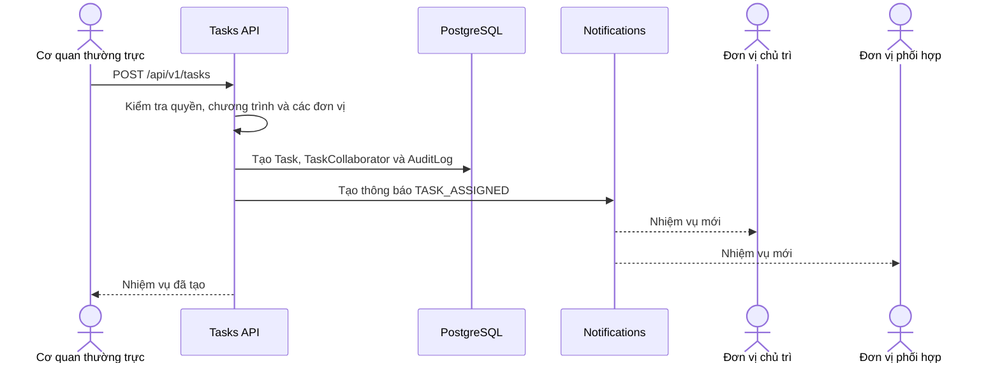
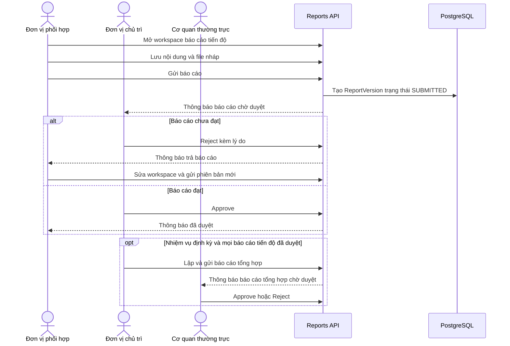
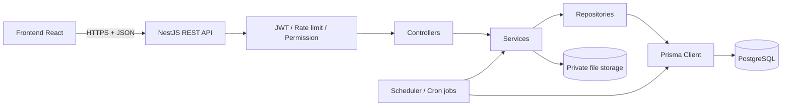
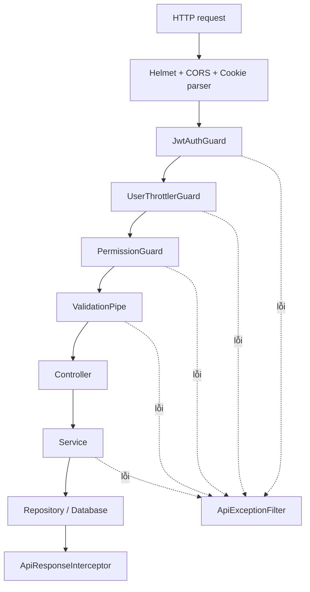
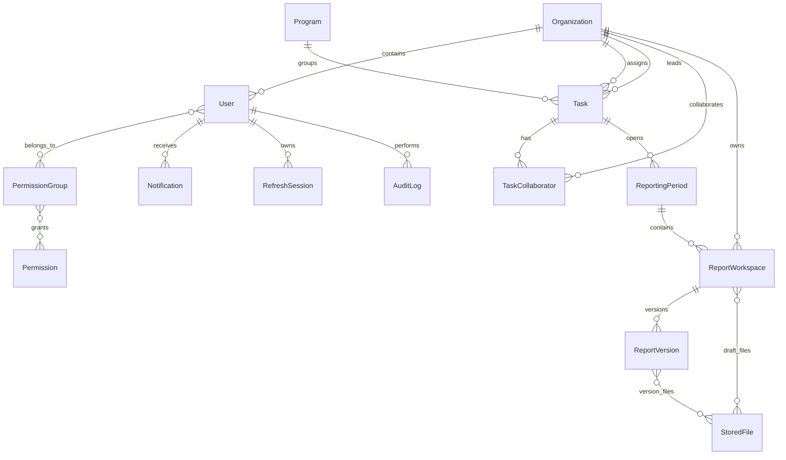

# Kiến trúc Backend hệ thống giao nhiệm vụ

Tài liệu này mô tả **đúng trạng thái code Backend hiện tại** trong thư mục
`BE`. Đối tượng đọc là developer mới, tester, BA hoặc người cần tra cứu một API
dùng để làm gì trước khi đọc mã nguồn.

## 1. Backend giải quyết bài toán gì?

Backend phục vụ quy trình giao nhiệm vụ giữa các đơn vị:

1. Cơ quan thường trực tạo nhiệm vụ và chỉ định đơn vị chủ trì.
2. Nhiệm vụ có một hoặc nhiều đơn vị phối hợp.
3. Đơn vị phối hợp lập báo cáo tiến độ và gửi cho đơn vị chủ trì.
4. Đơn vị chủ trì duyệt hoặc trả báo cáo để đơn vị phối hợp sửa và gửi lại.
5. Với nhiệm vụ định kỳ, đơn vị chủ trì lập báo cáo tổng hợp sau khi toàn bộ báo
   cáo phối hợp đã được duyệt.
6. Cơ quan thường trực hoặc Admin duyệt báo cáo tổng hợp.
7. Cơ quan thường trực có thể đánh dấu hoàn thành nhiệm vụ đột xuất.

Ngoài nghiệp vụ chính, Backend còn quản lý đăng nhập, người dùng, đơn vị, nhóm
quyền, file báo cáo, thông báo trong ứng dụng, dashboard và nhật ký audit.

## 2. Các khái niệm nghiệp vụ

| Khái niệm | Ý nghĩa trong hệ thống |
|---|---|
| Cơ quan giao | Đơn vị có `isAssigningAuthority = true`, tạo và giao nhiệm vụ. |
| Đơn vị chủ trì | Đơn vị chịu trách nhiệm chính, duyệt báo cáo tiến độ của phối hợp. |
| Đơn vị phối hợp | Đơn vị thực hiện một phần nhiệm vụ và gửi báo cáo tiến độ. |
| Chương trình | Danh mục/Nghị quyết mà nhiệm vụ trực thuộc. |
| Nhiệm vụ đột xuất | Có hạn hoàn thành `dueAt`; Backend tính 5 trạng thái thời hạn. |
| Nhiệm vụ định kỳ | Có `frequency` và ngày bắt đầu; Backend sinh các kỳ báo cáo. |
| Kỳ báo cáo | Một khoảng làm việc có hạn, trạng thái `OPEN`, `COMPLETED` hoặc `CANCELED`. |
| Report workspace | Bản làm việc hiện tại của một đơn vị trong một kỳ báo cáo. |
| Report version | Bản chụp bất biến được tạo mỗi lần người dùng gửi báo cáo. |
| Audit log | Lịch sử ai đã làm gì, lúc nào, trên dữ liệu nào. |

### Vai trò của người dùng

Người dùng thuộc đúng một `Organization` nhưng có thể thuộc nhiều
`PermissionGroup`. Vai trò đối với nhiệm vụ được xác định bằng quan hệ giữa đơn
vị của người dùng và nhiệm vụ, không lưu thành một cột role riêng trên nhiệm vụ.

| Nhóm quyền seed | Khả năng chính |
|---|---|
| `ADMIN` | Toàn quyền, phạm vi toàn hệ thống. |
| `THUONG_TRUC` | Giao, sửa, xóa, đóng/hoàn thành nhiệm vụ; duyệt báo cáo tổng hợp; xem audit. |
| `DON_VI` | Lập/gửi báo cáo tiến độ; duyệt tiến độ nếu là chủ trì; lập/gửi báo cáo tổng hợp. |
| `VIEWER` | Chỉ xem nhiệm vụ, lịch sử báo cáo và dashboard. |

Quyền được nạp lại từ database ở mỗi request. Backend không chỉ tin danh sách
quyền nằm trong JWT.

## 3. Luồng nghiệp vụ chính

### 3.1 Giao nhiệm vụ



Điều kiện quan trọng:

- Chỉ `ADMIN` hoặc `THUONG_TRUC` được giao nhiệm vụ.
- Người không phải Admin chỉ được giao dưới danh nghĩa đơn vị của chính mình.
- Phải có ít nhất một đơn vị phối hợp.
- Đơn vị chủ trì không đồng thời là đơn vị phối hợp.
- Chương trình và các đơn vị phải đang hoạt động.
- Không đổi loại nhiệm vụ sau khi tạo.
- Không đổi phân công sau khi đã phát sinh báo cáo hoặc nhiệm vụ đã kết thúc.

### 3.2 Báo cáo tiến độ và báo cáo tổng hợp



`ReportWorkspace` giữ bản nháp hiện tại. Khi submit, Backend tạo một
`ReportVersion` mới để giữ lịch sử. Báo cáo ở trạng thái `SUBMITTED` bị khóa
không cho sửa; báo cáo `REJECTED` được mở lại để sửa và gửi phiên bản tiếp theo.

### 3.3 Hoàn thành nhiệm vụ đột xuất

`POST /api/v1/tasks/:id/complete` là thao tác độc lập với việc duyệt báo cáo.
Cơ quan giao có thể hoàn thành nhiệm vụ đột xuất bất kỳ lúc nào. Thời điểm hoàn
thành lấy từ máy chủ.

| Trạng thái | Điều kiện |
|---|---|
| `DANG_THUC_HIEN` | Chưa hoàn thành và còn trên 5 ngày. |
| `SAP_DEN_HAN` | Chưa hoàn thành và hạn nằm trong 5 ngày tới. |
| `QUA_HAN` | Chưa hoàn thành và thời điểm hiện tại đã qua hạn. |
| `HOAN_THANH_DUNG_HAN` | `completedAt <= dueAt`. |
| `HOAN_THANH_QUA_HAN` | `completedAt > dueAt`. |

Cron job chạy lúc 00:05 mỗi ngày theo múi giờ `Asia/Ho_Chi_Minh` để đồng bộ
trường `deadlineStatus` của nhiệm vụ đột xuất. Có thể tắt toàn bộ scheduler
bằng `DISABLE_SCHEDULER=true`.

## 4. Kiến trúc tổng thể



Backend là một ứng dụng NestJS duy nhất, không chia microservice. Kiến trúc
chính:

```text
Controller → Service → Repository → PrismaService → PostgreSQL
```

| Tầng | Trách nhiệm |
|---|---|
| Controller | Khai báo URL, HTTP method, DTO, quyền và chuyển request vào service. |
| DTO | Kiểm tra kiểu, độ dài và định dạng dữ liệu đầu vào. |
| Guard | Xác thực JWT, giới hạn request và nạp quyền hiện hành. |
| Service | Chứa luật nghiệp vụ và kiểm tra phạm vi đơn vị. |
| Repository | Truy vấn database, transaction, row lock và ghi audit. |
| PrismaService | Kết nối Prisma với PostgreSQL qua driver adapter `pg`. |
| Job/Scheduler | Sinh kỳ báo cáo, thông báo hạn và cập nhật trạng thái nhiệm vụ. |

### Luồng của một request



## 5. Cấu trúc thư mục

```text
BE/
├── prisma/
│   ├── schema.prisma          # Mô hình dữ liệu
│   ├── migrations/            # Lịch sử thay đổi database
│   └── seed/                  # Dữ liệu quyền và tài khoản ban đầu
├── src/
│   ├── config/                # Cấu hình HTTP và biến môi trường
│   ├── controllers/           # Danh sách REST endpoint
│   ├── decorators/            # @CurrentUser, @Permissions, @Public
│   ├── dtos/                  # Kiểm tra request đầu vào
│   ├── filters/               # Chuẩn hóa lỗi API
│   ├── guards/                # JWT, CSRF, permission, rate limit
│   ├── interceptors/          # Chuẩn hóa response thành envelope
│   ├── jobs/                  # Cron cập nhật deadlineStatus
│   ├── prisma/                # Prisma client và PrismaService
│   ├── repositories/          # Truy cập DB và transaction
│   ├── services/              # Luật nghiệp vụ
│   ├── types/                 # Kiểu dữ liệu nội bộ
│   └── utils/                 # File, kỳ báo cáo, request metadata
├── storage/                   # File private nếu không cấu hình STORAGE_PATH
└── test/                      # Integration/E2E với PostgreSQL test
```

## 6. Mô hình dữ liệu



### Bảng dữ liệu quan trọng

| Model | Dùng để làm gì? |
|---|---|
| `Organization` | Đơn vị giao, chủ trì hoặc phối hợp. |
| `User` | Tài khoản đăng nhập, thuộc một đơn vị. |
| `PermissionGroup`, `Permission` | Phân quyền động theo nhóm. |
| `Program` | Chương trình/Nghị quyết chứa nhiệm vụ. |
| `Task` | Thông tin nhiệm vụ và trạng thái vòng đời. |
| `TaskCollaborator` | Quan hệ nhiều đơn vị phối hợp với một nhiệm vụ. |
| `ReportingPeriod` | Kỳ làm báo cáo của nhiệm vụ. |
| `ReportWorkspace` | Bản nháp hiện tại của một đơn vị. |
| `ReportVersion` | Phiên bản được lưu khi submit. |
| `StoredFile` | Metadata của file private trên ổ đĩa. |
| `Notification` | Thông báo của từng người dùng. |
| `AuditLog` | Nhật ký nghiệp vụ và bảo mật. |
| `RefreshSession` | Phiên refresh token có thể thu hồi/rotate. |

## 7. Quy ước chung của API

- Base URL: `http://localhost:3030/api/v1`
- Swagger UI: `http://localhost:3030/api/docs`
- API bảo vệ dùng header `Authorization: Bearer <accessToken>`.
- Request JSON bị từ chối nếu có field không được DTO khai báo.
- Phân trang mặc định `page=1`, `limit=20`, tối đa `limit=100`.

Response thành công:

```json
{
  "statusCode": 200,
  "data": {}
}
```

Response phân trang:

```json
{
  "statusCode": 200,
  "data": [],
  "meta": {
    "page": 1,
    "limit": 20,
    "total": 0,
    "totalPages": 0
  }
}
```

Response lỗi:

```json
{
  "statusCode": 400,
  "errorCode": "VALIDATION_ERROR",
  "message": "Nội dung lỗi",
  "requestId": "uuid-hoac-x-request-id"
}
```

## 8. Danh mục API

### 8.1 Authentication

| Method | Endpoint | Dùng để làm gì? | Xác thực |
|---|---|---|---|
| `POST` | `/auth/login` | Đăng nhập, trả access token và đặt refresh/CSRF cookie. | Public |
| `POST` | `/auth/refresh` | Rotate refresh session và cấp access token mới. | CSRF cookie/header |
| `POST` | `/auth/logout` | Thu hồi refresh session và xóa cookie. | CSRF cookie/header |
| `GET` | `/auth/profile` | Lấy user, đơn vị và quyền hiện hành. | Bearer token |
| `PATCH` | `/auth/change-password` | Đổi mật khẩu và thu hồi các phiên cũ. | Bearer token |

Access token sống 15 phút; refresh session sống tối đa 3 ngày. Năm lần đăng
nhập sai trong 60 giây khóa tài khoản 5 phút.

### 8.2 Tasks và reporting periods

| Method | Endpoint | Dùng để làm gì? | Quyền/phạm vi |
|---|---|---|---|
| `GET` | `/tasks` | Danh sách nhiệm vụ người dùng được phép thấy. | `tasks.read` |
| `POST` | `/tasks` | Tạo và giao nhiệm vụ. | `tasks.create`, `tasks.assign`; Admin/Thường trực |
| `GET` | `/tasks/lookups/organizations` | Danh sách đơn vị hoạt động cho form nhiệm vụ. | `tasks.read` |
| `GET` | `/tasks/lookups/programs` | Danh sách chương trình hoạt động. | `tasks.read` |
| `GET` | `/tasks/:id` | Chi tiết nhiệm vụ trong phạm vi đơn vị. | `tasks.read` |
| `PATCH` | `/tasks/:id` | Sửa nhiệm vụ hoặc phân công. | `tasks.update`; Admin/Thường trực |
| `DELETE` | `/tasks/:id` | Xóa mềm nhiệm vụ. | `tasks.delete`; Admin/Thường trực |
| `POST` | `/tasks/:id/close` | Đóng vĩnh viễn nhiệm vụ định kỳ, cần lý do. | `tasks.close`; Admin/Thường trực |
| `POST` | `/tasks/:id/complete` | Hoàn thành nhiệm vụ đột xuất theo giờ máy chủ. | `tasks.complete`; cơ quan giao/Admin |
| `GET` | `/tasks/:id/reporting-periods` | Lấy các kỳ báo cáo của nhiệm vụ. | `tasks.read` |
| `GET` | `/reporting-periods/:id/report-workspaces` | Chủ trì/Thường trực xem workspace trong một kỳ. | `tasks.read`; phạm vi review |
| `POST` | `/reporting-periods/:id/cancel` | Hủy một kỳ đang mở, cần lý do. | `tasks.close`; Admin/Thường trực |

Ví dụ tạo nhiệm vụ đột xuất:

```json
{
  "code": "NV-001",
  "name": "Kiểm tra an toàn hệ thống",
  "description": "Kiểm tra và lập báo cáo",
  "expectedOutput": "Báo cáo kết quả",
  "type": "DOT_XUAT",
  "programId": 1,
  "assigningOrganizationId": 1,
  "leadOrganizationId": 2,
  "collaboratorOrganizationIds": [3],
  "dueAt": "2026-08-31T17:00:00.000Z"
}
```

Theo code hiện tại, nhiệm vụ định kỳ phải có `frequency` và
`periodicStartAt`; ngày của `periodicStartAt` bắt buộc là ngày 15.

### 8.3 Progress reports

Nhóm API này dành cho đơn vị phối hợp lập báo cáo và đơn vị chủ trì review.
`:id` trong các endpoint sau là `ReportWorkspace.id`.

| Method | Endpoint | Dùng để làm gì? | Quyền/phạm vi |
|---|---|---|---|
| `GET` | `/progress-reports/periods/:periodId` | Tìm hoặc tạo workspace tiến độ cho đơn vị phối hợp. | `progress.edit`; đúng đơn vị phối hợp |
| `GET` | `/progress-reports/:id` | Xem workspace tiến độ. | `tasks.read`; đúng phạm vi |
| `PATCH` | `/progress-reports/:id` | Lưu nội dung nháp. | `progress.edit`; chủ workspace |
| `POST` | `/progress-reports/:id/submit` | Tạo phiên bản và gửi chủ trì duyệt. | `progress.submit`; chủ workspace |
| `POST` | `/progress-reports/:id/approve` | Chủ trì duyệt phiên bản mới nhất. | `progress.review`; đúng đơn vị chủ trì |
| `POST` | `/progress-reports/:id/reject` | Chủ trì trả báo cáo kèm lý do. | `progress.review`; đúng đơn vị chủ trì |
| `POST` | `/progress-reports/:id/files` | Upload file vào bản nháp. | `progress.edit`; multipart field `file` |
| `DELETE` | `/progress-reports/:id/files/:fileId` | Xóa file khỏi bản nháp. | `progress.edit`; chủ workspace |
| `GET` | `/progress-reports/:id/files/:fileId/download` | Tải file private của workspace. | `tasks.read`; đúng phạm vi |

### 8.4 Consolidated reports

Nhóm API này có cấu trúc giống progress report nhưng dành cho đơn vị chủ trì.
Theo code hiện tại, chỉ nhiệm vụ `DINH_KY` có báo cáo tổng hợp và chỉ mở khi mọi
báo cáo tiến độ của kỳ đã được duyệt.

| Method | Endpoint | Dùng để làm gì? | Quyền/phạm vi |
|---|---|---|---|
| `GET` | `/consolidated-reports/periods/:periodId` | Tìm hoặc tạo workspace tổng hợp. | `consolidated.edit`; chủ trì/Admin |
| `GET` | `/consolidated-reports/:id` | Xem workspace tổng hợp. | `tasks.read`; đúng phạm vi |
| `PATCH` | `/consolidated-reports/:id` | Lưu nội dung tổng hợp nháp. | `consolidated.edit`; chủ workspace |
| `POST` | `/consolidated-reports/:id/submit` | Gửi báo cáo tổng hợp cho cơ quan giao. | `consolidated.submit` |
| `POST` | `/consolidated-reports/:id/approve` | Duyệt báo cáo tổng hợp. | `consolidated.review`; Admin/Thường trực |
| `POST` | `/consolidated-reports/:id/reject` | Trả báo cáo tổng hợp kèm lý do. | `consolidated.review`; Admin/Thường trực |
| `POST` | `/consolidated-reports/:id/files` | Upload file vào bản nháp. | `consolidated.edit` |
| `DELETE` | `/consolidated-reports/:id/files/:fileId` | Xóa file nháp. | `consolidated.edit` |
| `GET` | `/consolidated-reports/:id/files/:fileId/download` | Tải file private của workspace. | `tasks.read`; đúng phạm vi |

### 8.5 Report history

| Method | Endpoint | Dùng để làm gì? | Quyền |
|---|---|---|---|
| `GET` | `/report-history` | Tra cứu các phiên bản báo cáo đã submit. | `report_history.read` |
| `GET` | `/report-history/versions/:versionId/files/:fileId/download` | Tải file gắn với một phiên bản lịch sử. | `report_history.read`; đúng phạm vi |

Các bộ lọc gồm mã/tên nhiệm vụ, ngày submit, tần suất, hạn và chương trình.

### 8.6 System administration

Tất cả endpoint dưới đây chỉ dành cho người có quyền quản trị tương ứng.

| Method | Endpoint | Dùng để làm gì? | Quyền |
|---|---|---|---|
| `GET` | `/system/users` | Danh sách người dùng. | `users.manage` |
| `GET` | `/system/users/:id` | Chi tiết người dùng. | `users.manage` |
| `POST` | `/system/users` | Tạo user, gán đơn vị và nhóm quyền. | `users.manage` |
| `PATCH` | `/system/users/:id` | Sửa thông tin hoặc nhóm quyền user. | `users.manage` |
| `DELETE` | `/system/users/:id` | Xóa mềm user. | `users.manage` |
| `POST` | `/system/users/:id/lock` | Khóa user kèm lý do. | `users.manage` |
| `POST` | `/system/users/:id/unlock` | Mở khóa user. | `users.manage` |
| `POST` | `/system/users/:id/reset-password` | Đặt mật khẩu mới tối thiểu 12 ký tự. | `users.manage` |
| `GET/POST` | `/system/organizations` | Liệt kê hoặc tạo đơn vị. | `organizations.manage` |
| `GET/PATCH/DELETE` | `/system/organizations/:id` | Xem, sửa hoặc xóa đơn vị. | `organizations.manage` |
| `GET/POST` | `/system/programs` | Liệt kê hoặc tạo chương trình. | `programs.manage` |
| `GET/PATCH/DELETE` | `/system/programs/:id` | Xem, sửa hoặc xóa chương trình. | `programs.manage` |
| `GET/POST` | `/system/permission-groups` | Liệt kê hoặc tạo nhóm quyền. | `permission_groups.manage` |
| `GET/PATCH/DELETE` | `/system/permission-groups/:id` | Xem, sửa hoặc xóa nhóm quyền. | `permission_groups.manage` |
| `GET` | `/system/permissions` | Danh sách quyền có thể gán cho nhóm. | `permission_groups.manage` |

### 8.7 Dashboard và statistics

| Method | Endpoint | Dùng để làm gì? | Quyền |
|---|---|---|---|
| `GET` | `/dashboard/summary` | Tổng số nhiệm vụ, loại, trạng thái và kỳ báo cáo. | `dashboard.read` |
| `GET` | `/statistics/tasks` | Hiện dùng cùng kết quả và xử lý với dashboard summary. | `dashboard.read` |

Bộ lọc hỗ trợ mã/tên nhiệm vụ, tần suất, năm, số kỳ, chương trình và khoảng hạn.
Admin/Thường trực xem toàn hệ thống; đơn vị thường chỉ xem nhiệm vụ liên quan.

### 8.8 Notifications

| Method | Endpoint | Dùng để làm gì? | Xác thực |
|---|---|---|---|
| `GET` | `/notifications` | Danh sách thông báo của user; hỗ trợ `unreadOnly`. | Bearer token |
| `POST` | `/notifications/:id/read` | Đánh dấu một thông báo đã đọc. | Đúng người nhận |
| `POST` | `/notifications/read-all` | Đánh dấu toàn bộ thông báo đã đọc. | Bearer token |

Thông báo được lưu trong database để Frontend chủ động tải. Backend hiện không
có WebSocket hoặc Server-Sent Events.

### 8.9 Audit logs

| Method | Endpoint | Dùng để làm gì? | Quyền |
|---|---|---|---|
| `GET` | `/audit-logs` | Tra cứu hành động theo actor, đơn vị, entity và thời gian. | `audit.read` |

Audit ghi các nhóm hành động như đăng nhập, khóa tài khoản, thay đổi mật khẩu,
tạo/sửa/xóa nhiệm vụ, submit/review báo cáo và upload/download file.

### 8.10 Health check

| Method | Endpoint | Dùng để làm gì? | Xác thực |
|---|---|---|---|
| `GET` | `/system/health/live` | Xác nhận process NestJS đang phản hồi. | Public |
| `GET` | `/system/health/ready` | Hiện trả `status: ok` giống live. | Public |

`ready` hiện chưa kiểm tra kết nối PostgreSQL hoặc khả năng ghi file storage.

## 9. File báo cáo

- File nằm ngoài public web root, tại `STORAGE_PATH` hoặc `BE/storage`.
- Chỉ chấp nhận `pdf`, `doc`, `docx`, `xls`, `xlsx`.
- Phần mở rộng, MIME và chữ ký nội dung phải khớp.
- Tổng file của một draft tối đa 200 MB.
- Tên lưu trên đĩa là UUID; tên gốc chỉ dùng khi tải xuống.
- Backend tính SHA-256 và ghi audit khi upload, xóa hoặc download.
- Khi submit, liên kết file được chụp sang `VersionAttachment`; version cũ không
  bị thay đổi khi draft tiếp tục được sửa.

## 10. Scheduler và tác vụ nền

| Tác vụ | Thời điểm | Chức năng |
|---|---|---|
| `TaskStatusJob` | 00:05 mỗi ngày (`Asia/Ho_Chi_Minh`) | Tính lại 5 trạng thái deadline của nhiệm vụ đột xuất. |
| `ReportingPeriodsService` | Khi ứng dụng khởi động và 00:05 mỗi ngày | Sinh kỳ còn thiếu cho nhiệm vụ định kỳ. |
| Deadline notifications | Cùng tác vụ 00:05 | Tạo thông báo kỳ sắp đến hạn hoặc quá hạn. |

Scheduler chạy trong process Backend. Nếu chạy nhiều replica Backend đồng thời,
mỗi replica đều khởi động scheduler; tính duy nhất của database/event key giúp
giảm bản ghi trùng nhưng đây không phải một worker service riêng.

## 11. Bảo mật

- `helmet` thiết lập HTTP security headers.
- CORS chỉ cho phép các origin trong `CORS_ORIGINS`.
- Access token dùng JWT HS256, issuer `congan-api`, audience `congan-web`.
- Refresh token chỉ nằm trong cookie `HttpOnly`; database chỉ lưu SHA-256 hash.
- Refresh token được rotate; phát hiện reuse sẽ thu hồi toàn bộ session của user.
- Refresh/logout dùng kiểm tra Origin và mô hình double-submit CSRF token.
- Mật khẩu được hash bằng Argon2id.
- Rate limit mặc định 120 request/phút theo user hoặc IP.
- Login giới hạn 10/phút; refresh/logout 30/phút; đổi mật khẩu 5/phút.
- Mọi thao tác vẫn kiểm tra cả permission và phạm vi đơn vị trong service.
- `JWT_SECRET` và `CSRF_SECRET` bắt buộc tối thiểu 32 byte.

## 12. Các hành vi hiện tại cần biết

Đây là mô tả hiện trạng, không phải đề xuất:

1. Code vẫn có `Frequency`, `ReportingPeriod` và lịch sinh kỳ báo cáo cho nhiệm
   vụ định kỳ.
2. Nhiệm vụ đột xuất tạo một `ReportingPeriod` duy nhất khi tạo nhiệm vụ.
3. Code hiện từ chối báo cáo tổng hợp cho nhiệm vụ đột xuất.
4. Duyệt hết báo cáo không tự hoàn thành nhiệm vụ. Cơ quan giao phải gọi API
   `complete`.
5. Hoàn thành nhiệm vụ không bắt buộc báo cáo đã được duyệt.
6. Mã nhiệm vụ có unique constraint nhưng service hiện so sánh đúng chuỗi đã
   nhập; chưa tự chuyển uppercase và chưa kiểm tra khác biệt hoa/thường.
7. Xóa nhiệm vụ và người dùng là xóa mềm bằng `deletedAt`.
8. Thông báo là dữ liệu lưu trong PostgreSQL để Frontend polling; chưa có push
   realtime từ Backend.
9. Dashboard dùng bộ trạng thái tổng hợp cũ
   `CHUA_HOAN_THANH/SAP_DEN_HAN/QUA_HAN/DANG_CAP_NHAT/HOAN_THANH`, khác với
   trường `Task.deadlineStatus` năm trạng thái của nhiệm vụ đột xuất.
10. Endpoint readiness hiện chưa xác nhận PostgreSQL đang sẵn sàng.

## 13. Biến môi trường

| Biến | Ý nghĩa |
|---|---|
| `PORT` | Cổng Backend, mặc định `3030`. |
| `DATABASE_URL` | PostgreSQL connection string. |
| `CORS_ORIGINS` | Danh sách Frontend origin, phân tách bằng dấu phẩy. |
| `JWT_SECRET` | Khóa ký JWT, tối thiểu 32 byte. |
| `CSRF_SECRET` | Khóa ký CSRF token, tối thiểu 32 byte. |
| `TRUST_PROXY_HOPS` | Số reverse proxy tin cậy. |
| `STORAGE_PATH` | Thư mục private lưu file báo cáo. |
| `DISABLE_SCHEDULER` | Đặt `true` để tắt scheduler. |
| `SEED_ADMIN_PASSWORD` | Mật khẩu tài khoản admin khi seed. |

## 14. Cách đọc code cho người mới

Khi cần hiểu một API, đọc theo thứ tự:

1. Tìm route trong `src/controllers`.
2. Đọc DTO tương ứng trong `src/dtos` để biết input hợp lệ.
3. Đọc method cùng tên trong `src/services` để hiểu luật nghiệp vụ và quyền.
4. Đọc `src/repositories` nếu cần biết transaction hoặc câu truy vấn.
5. Đối chiếu model trong `prisma/schema.prisma`.
6. Đọc file `.spec.ts` cùng service để xem các trường hợp được bảo vệ.

Ví dụ với API hoàn thành nhiệm vụ:

```text
TasksController.complete
  → TasksService.complete
    → calculateTaskDeadlineStatus
    → TasksRepository.complete
      → Task + AuditLog trong PostgreSQL
```

Các điểm bắt đầu hữu ích:

- `src/app.module.ts`: toàn bộ thành phần được đăng ký.
- `src/config/app.ts`: pipeline HTTP toàn cục.
- `src/controllers/index.ts`: danh sách controller.
- `src/services/index.ts`: danh sách service.
- `src/repositories/index.ts`: danh sách repository.
- `prisma/schema.prisma`: nguồn sự thật của mô hình dữ liệu.
