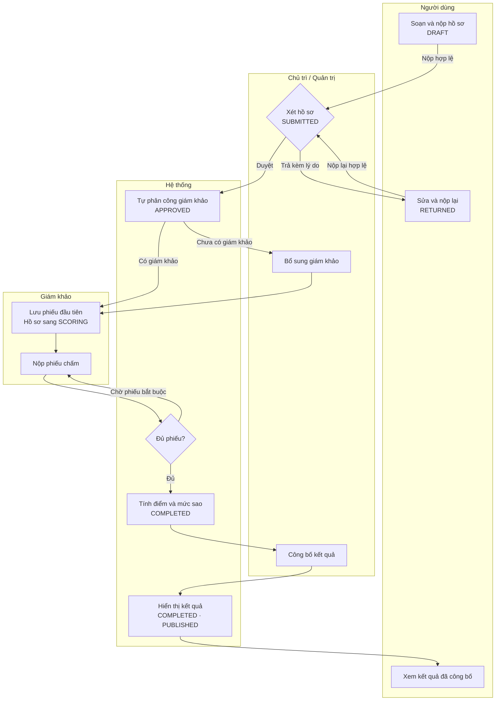

# Quy trình đánh giá hồ sơ OCOP

Người dùng nộp hồ sơ. Chủ trì hoặc Quản trị duyệt để chuyển sang chấm, hoặc trả hồ sơ kèm lý do để Người dùng sửa và nộp lại. Sau khi hệ thống hoàn tất tính điểm, Chủ trì hoặc Quản trị công bố kết quả.

## Ai làm gì

| Vai trò            | Việc cần làm                                                                                                         |
| ------------------ | -------------------------------------------------------------------------------------------------------------------- |
| Người dùng         | Soạn hồ sơ của mình, nộp, sửa theo lý do trả nếu có và xem kết quả sau công bố.                                      |
| Chủ trì / Quản trị | Xét hồ sơ chờ duyệt, theo dõi và điều chỉnh phân công giám khảo, công bố kết quả.                                    |
| Giám khảo          | Chấm hồ sơ được phân công, lưu nháp và nộp phiếu khi đã chấm đủ phần được giao.                                      |
| Hệ thống           | Kiểm tra điều kiện nộp, tự phân công khi duyệt, cập nhật trạng thái hồ sơ và tính điểm, mức sao từ các phiếu hợp lệ. |

Tên vai trò theo [thuật ngữ của dự án](../GLOSSARY.md#vai-trò). Tên trạng thái trên các màn hình có thể khác nhau đôi chút. Mã trạng thái trong tài liệu dùng để tra cứu trong code. [Nhãn trạng thái trên giao diện](../apps/web/src/constants/product-status.ts#L32)

## Sơ đồ phân làn

## Đọc theo trạng thái hồ sơ

| Trạng thái                  | Ai xử lý và bước tiếp theo                                                                                                                                                                                                                                                                                                     |
| --------------------------- | ------------------------------------------------------------------------------------------------------------------------------------------------------------------------------------------------------------------------------------------------------------------------------------------------------------------------------ |
| **Bản nháp** (`DRAFT`)      | Người dùng hoàn thiện Mẫu số 01 và nộp. Hệ thống kiểm tra dữ liệu bắt buộc, phân loại và địa bàn. Nếu hồ sơ chưa hợp lệ, Người dùng sửa tại trạng thái hiện tại. Nộp thành công chuyển sang `SUBMITTED`.                                                                                                                       |
| **Chờ duyệt** (`SUBMITTED`) | Chủ trì/Quản trị chọn **Duyệt hồ sơ** hoặc **Trả hồ sơ** kèm lý do. Duyệt chuyển sang `APPROVED`. Trả chuyển sang `RETURNED`.                                                                                                                                                                                                  |
| **Bị trả lại** (`RETURNED`) | Người dùng đọc lý do, sửa **cùng hồ sơ** rồi nộp lại. Nộp hợp lệ đưa hồ sơ về `SUBMITTED` và xóa lý do trả cũ.                                                                                                                                                                                                                 |
| **Đã duyệt** (`APPROVED`)   | Hệ thống tự phân công giám khảo đủ điều kiện thuộc các cơ quan quản lý của phân loại sản phẩm. Nếu chưa có người có thể chấm, Chủ trì/Quản trị bổ sung ở tab **Tiến độ**. Hồ sơ chuyển sang `SCORING` khi Giám khảo lưu phiếu chấm đầu tiên.                                                                                   |
| **Đang chấm** (`SCORING`)   | Giám khảo chấm đủ phần được giao và nộp phiếu. Với phân công theo hồ sơ, hệ thống cần ít nhất một phiếu hợp lệ và đủ phiếu của các giám khảo đang được đánh dấu phải nộp. Giám khảo được phân công tự động không mặc định thuộc diện phải chờ. Khi đủ điều kiện, hệ thống tính điểm, mức sao và chuyển hồ sơ sang `COMPLETED`. |
| **Hoàn tất** (`COMPLETED`)  | Chủ trì/Quản trị kiểm tra điểm và mức sao, rồi chọn **Công bố kết quả**. Hồ sơ giữ `COMPLETED` và trạng thái công bố chuyển sang `PUBLISHED`. Từ đó Người dùng và trang công khai mới nhận điểm và mức sao đã công bố.                                                                                                         |

Nếu mở lại một hồ sơ đã công bố để chấm bổ sung, hồ sơ quay về `SCORING` và trạng thái công bố chuyển sang `UPDATING`. Người dùng chưa thấy điểm và mức sao trong thời gian cập nhật. Khi hồ sơ hoàn tất chấm lại, Chủ trì/Quản trị công bố lại. Với hồ sơ cũ chưa có phân công riêng, hệ thống có thể dùng phân công theo phân loại và áp dụng điều kiện hoàn tất của cơ chế đó. [Mở lại hồ sơ](../apps/be/src/repositories/admin.repository.ts#L1400) · [Hiển thị kết quả](../apps/be/src/repositories/products.repository.ts#L106) · [Tính kết quả theo phân loại](../apps/be/src/utils/evaluation-result.ts#L237)

## Code và test đối chiếu

| Luồng                  | Code                                                                                                                                                                                                                                             | Test                                                                                                                                                                                                                                                                              |
| ---------------------- | ------------------------------------------------------------------------------------------------------------------------------------------------------------------------------------------------------------------------------------------------ | --------------------------------------------------------------------------------------------------------------------------------------------------------------------------------------------------------------------------------------------------------------------------------- |
| Nộp, trả và nộp lại    | [Kiểm tra và lưu khi nộp](../apps/be/src/repositories/products.repository.ts#L592) · [Bắt buộc lý do trả](../apps/be/src/services/admin.service.ts#L388) · [Chuyển sang `RETURNED`](../apps/be/src/repositories/admin.repository.ts#L1247)       | [Thiếu dữ liệu thì giữ bản nháp](../apps/be/test/admin-products.db-spec.ts#L812) · [Nộp lại cùng hồ sơ sau khi bị trả](../apps/be/test/workflow-issues-6-to-13.db-spec.ts#L390)                                                                                                   |
| Duyệt và phân công     | [Duyệt hồ sơ và chọn giám khảo](../apps/be/src/repositories/admin.repository.ts#L1078) · [Bổ sung giám khảo trong tab Tiến độ](../apps/web/src/pages/admin/AdminProductDetailPage.tsx#L708)                                                      | [Tự phân công theo cơ quan quản lý, kể cả khi một cơ quan thiếu giám khảo](../apps/be/test/workflow-issues-6-to-13.db-spec.ts#L456)                                                                                                                                               |
| Chấm và hoàn tất       | [Lưu phiếu đầu tiên](../apps/be/src/repositories/evaluations.repository.ts#L442) · [Kiểm tra và nộp phiếu](../apps/be/src/repositories/evaluations.repository.ts#L470) · [Điều kiện tự hoàn tất](../apps/be/src/utils/evaluation-result.ts#L149) | [Lưu nháp đưa hồ sơ sang đang chấm](../apps/be/test/e2e-honey-flow.db-spec.ts#L539) · [Hoàn tất sau phiếu tự động đầu tiên](../apps/be/test/workflow-issues-6-to-13.db-spec.ts#L513) · [Chờ phiếu của giám khảo bổ sung](../apps/be/test/workflow-issues-6-to-13.db-spec.ts#L629) |
| Công bố và công bố lại | [Quyền thao tác](../apps/be/src/controllers/admin-products.controller.ts#L166) · [Điều kiện và trạng thái công bố](../apps/be/src/repositories/admin.repository.ts#L1308)                                                                        | [Ẩn điểm trước công bố và hiện điểm sau công bố](../apps/be/test/workflow-issues-6-to-13.db-spec.ts#L545) · [Ẩn kết quả khi cập nhật và công bố lại](../apps/be/test/workflow-issues-6-to-13.db-spec.ts#L670)                                                                     |
