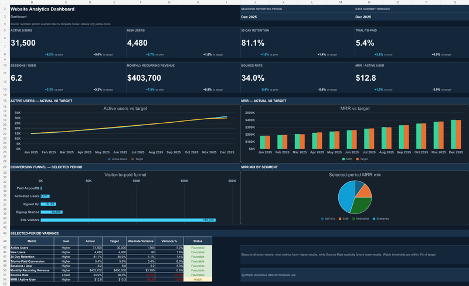

# Đặc tả mở rộng 7 phân hệ quản trị OCOP

Ngày: 17/10/2026. Phiên bản: dự thảo 1.0 để duyệt nghiệp vụ và lập kế hoạch triển khai. Tài liệu mô tả chức năng đề xuất; các màn hình/API mới bên dưới chưa được triển khai.

## 1. Mục tiêu, căn cứ và ranh giới

Mở rộng khu vực quản trị thành 7 phân hệ: người dùng; nhóm/phân loại sản phẩm; sản phẩm; phiếu chấm và in kết quả; phiếu đăng ký; báo cáo thống kê; Dashboard. Các màn hình dùng chung tài khoản, danh mục và hồ sơ hiện có, để một hồ sơ được theo dõi xuyên suốt từ đăng ký đến kết quả.

Nguồn đối chiếu mã nguồn:

- [Schema dữ liệu hiện tại](../../../apps/api/prisma/schema.prisma), [AdminController](../../../apps/api/src/controllers/admin.controller.ts), [AdminRepository](../../../apps/api/src/repositories/admin.repository.ts).
- [Màn hình admin hiện tại](../../../apps/web/src/pages/AdminPages.tsx), [điều hướng](../../../apps/web/src/layouts/AppLayout.tsx), [types dùng chung](../../../packages/shared/src/index.ts).
- [Danh mục 26 phân loại](../../../apps/api/prisma/seed-data/categories.json), các bộ tiêu chí trong [seed-data](../../../apps/api/prisma/seed-data), [quy tắc tính điểm](../../../apps/api/src/utils/scoring.ts), [điều kiện hoàn tất kết quả](../../../apps/api/src/utils/evaluation-result.ts).
- [Spec tích hợp FE–BE](2026-10-15-fe-be-api-integration.md) tiếp tục áp dụng cho xác thực, envelope HTTP, upload và các luồng hiện có. Tài liệu này mở rộng phạm vi admin của spec đó.

Căn cứ đối chiếu biểu mẫu là [Quyết định 26/2026/QĐ-TTg trên Cổng văn bản Chính phủ](https://vanban.chinhphu.vn/?classid=1&docid=218267&orggroupid=3&pageid=27160), ban hành và có hiệu lực ngày 22/05/2026; [bản PDF ký số](https://datafiles.chinhphu.vn/cpp/files/vbpq/2026/5/26-ttg-2026.signed.pdf) là nguồn kiểm tra nội dung in. Việc lấy đủ dữ liệu seed không thay cho đối chiếu từng tiêu chí với bản ký.

Giữ React/Vite/TanStack Router, NestJS/Prisma/PostgreSQL, API prefix `/api`, client và lưu tệp private hiện có. Không thêm một hệ thống BI riêng, trình thiết kế tiêu chí tùy ý, chữ ký số hoặc quy trình cấp giấy chứng nhận trong đợt này. Chức năng in sử dụng trang in của ứng dụng và In/Lưu PDF của trình duyệt.

### 1.1. Các quyết định và giả định

| Nội dung | Quy định của bản đặc tả | Trạng thái |
|---|---|---|
| Kết hợp quyền | Một tài khoản nội bộ được kết hợp Quản trị, Xem và Chấm điểm. | Người dùng đã xác nhận. |
| Phạm vi quyền Xem | Mặc định xem toàn phạm vi triển khai của một tỉnh/thành phố; đơn vị công tác không tự tạo ranh giới dữ liệu. Chấm điểm luôn theo phân công. | Giả định; câu hỏi về phạm vi chưa có trả lời. |
| Sản phẩm và hồ sơ đăng ký | Một `Product` hiện tại là một lần đăng ký/đánh giá sản phẩm. Hai phân hệ hiển thị hai góc nhìn trên cùng bản ghi, cùng ID. | Đề xuất theo mô hình hiện có. |
| Đạt/không đạt | Báo cáo dùng kết quả điểm đã hoàn tất: từ 50 điểm là đạt ngưỡng 3 sao theo điểm; dưới 50 là chưa đạt ngưỡng. Hồ sơ chưa chấm xong được tách riêng. | Quy ước thống kê đề xuất. |
| Hạng sao | `starRating` là mức sao tính từ điểm trong hệ thống. Không tự coi là đã có quyết định công nhận; nhất là mức điểm 5 sao. | Ràng buộc hiển thị và in. |
| Danh mục đơn vị/địa bàn | Nạp mã, tên thực tế do đơn vị vận hành cung cấp; không tự suy ra xã/phường từ địa chỉ nhập tay. | Đầu vào triển khai cần cung cấp. |

Nếu lựa chọn phạm vi Xem theo đơn vị/địa bàn, phải bổ sung ma trận phạm vi và quan hệ đơn vị xử lý hồ sơ trước khi triển khai quyền đó. Không dùng đơn vị của giám khảo để suy ra hồ sơ thuộc đơn vị nào.

## 2. Bản đồ phân hệ và menu

| STT | Phân hệ/menu | Đường dẫn FE đề xuất | Tái sử dụng và phần bổ sung |
|---|---|---|---|
| 1 | Người dùng | `/admin/users` | Mở rộng quản lý giám khảo thành quản lý người dùng; thêm quyền kết hợp và tab Đơn vị. |
| 2 | Nhóm sản phẩm | `/admin/product-groups` | Quản lý 6 nhóm lớn, 26 phân loại và liên kết bộ phiếu; thêm tab Địa bàn phục vụ thống kê. |
| 3 | Sản phẩm | `/admin/products` | Mở rộng danh sách hiện có bằng tìm kiếm, bộ lọc, chi tiết và kết quả. |
| 4 | Phiếu chấm OCOP | `/admin/scoring-forms` | Danh mục 26 mẫu; tab Phiếu đã chấm; liên kết màn Phân công hiện có. |
| 5 | Phiếu đăng ký | `/admin/registrations` | Danh sách, nhập hộ bản nháp, ảnh/tệp và in đăng ký trên cùng `Product`. |
| 6 | Báo cáo thống kê | `/admin/reports` | Thống kê theo tháng/năm, xã/phường, nhóm/phân loại và mức sao. |
| 7 | Dashboard | `/admin` | Mở rộng tổng quan hiện có theo bộ lọc, KPI và biểu đồ. |

Giữ liên kết `/admin/assignments`. Liên kết `/admin/judges` cũ chuyển tới Người dùng với bộ lọc người có quyền Chấm điểm. Người có quyền Chấm điểm có thêm menu **Hồ sơ được phân công** tới `/judge`, kể cả khi đồng thời có quyền Quản trị.

Đây là các màn hình admin mới/mở rộng, không thay các màn chủ thể `/my/products` hoặc trang công khai.

## 3. Mô hình quyền và đơn vị

### 3.1. Ba quyền nội bộ cố định

- `MANAGE` — Quản trị: quản lý người dùng, danh mục, phân công và hồ sơ theo quy tắc trạng thái. Bao hàm quyền Xem.
- `VIEW` — Xem: đọc hồ sơ đã nộp, phiếu chấm đã nộp, kết quả, báo cáo và Dashboard; in dữ liệu được phép xem.
- `SCORE` — Chấm điểm: xem hồ sơ/tệp được phân công, lưu và nộp phiếu của chính mình. Không mặc nhiên có quyền xem toàn hệ thống.

Không xây bộ máy phân quyền tùy ý theo từng nút. `SCORE` chỉ có hiệu lực khi tài khoản active, verified và có phân công nhóm/phân loại/tiêu chí phù hợp. `MANAGE` không tự cấp `SCORE`.

| Thao tác | MANAGE | VIEW | SCORE đứng riêng | Chủ thể REGISTRANT |
|---|---|---|---|---|
| Người dùng, quyền, đơn vị | Quản lý | Không | Không | Chỉ tài khoản cá nhân |
| Nhóm/phân loại/địa bàn | Quản lý | Đọc danh mục | Đọc phần phục vụ phiếu | Đọc danh mục đăng ký |
| Sản phẩm, đăng ký đã nộp, tệp private | Toàn phạm vi triển khai | Toàn phạm vi triển khai | Hồ sơ được phân công | Hồ sơ của mình |
| Bản nháp đăng ký | Xem/nhập hộ có audit | Không | Không | Bản nháp của mình |
| Tạo/sửa/xóa đăng ký | Chỉ bản nháp | Không | Không | Chỉ bản nháp của mình |
| Phân công | Quản lý | Đọc | Đọc phân công của mình | Không |
| Ghi điểm, nộp phiếu | Chỉ khi có thêm SCORE và phân công | Chỉ khi có thêm SCORE và phân công | Phiếu của mình | Không |
| Đọc phiếu đã nộp và in kết quả | Có | Có | Phiếu của mình | Kết quả hồ sơ của mình theo luồng hiện có |
| Nội dung phiếu chấm nháp | Giữ quyền đọc admin hiện có, không sửa hộ | Không | Chỉ phiếu của mình | Không |
| Báo cáo, Dashboard | Có | Có | Không | Không |

Các quyền được cộng theo bảng; không có quyền nào cho phép sửa phiếu chấm đã nộp hoặc nhập đè `finalScore`/`starRating`.

### 3.2. Tương thích với vai trò hiện có

Thêm `staffPermissions` là mảng enum cố định vào User. BE là nơi tính quyền hiệu lực. Giữ trường `role` cho các client/luồng cũ, đồng bộ từ quyền của tài khoản nội bộ theo ưu tiên: có MANAGE → ADMIN; nếu không, có SCORE → JUDGE; nếu chỉ VIEW → VIEWER mới. REGISTRANT vẫn là tài khoản chủ thể, không tự nhận quyền nội bộ.

Migration ban đầu: ADMIN → MANAGE và VIEW; JUDGE → SCORE; REGISTRANT → không có quyền nội bộ. Không cấp VIEW toàn hệ thống cho toàn bộ giám khảo cũ. Tài khoản nội bộ active phải có ít nhất một quyền. Chuyển tài khoản chủ thể thành tài khoản nội bộ không phải thao tác đổi checkbox trong đợt này.

`/auth/login` và `/auth/me` bổ sung quyền hiệu lực và đơn vị. Route guards, sidebar, redirect sau login và guard BE dùng cùng hợp đồng này. Mọi truy vấn/kiểm tra giám khảo đang dùng `role = JUDGE` phải nhận cả tài khoản ADMIN có SCORE, gồm danh sách phân công, chấm, tải tệp và thống kê tiến độ.

Thay quyền, khóa tài khoản hoặc reset mật khẩu làm tăng `tokenVersion`; phiên cũ bị thu hồi. Thay phân công được kiểm tra từ DB tại mỗi thao tác, không dựa vào danh sách trong token hoặc localStorage. Guard ADMIN chung ở controller phải được chuyển thành kiểm quyền từng method để VIEW đọc được nhưng không có quyền ghi.

## 4. Phân hệ 1 — Danh mục người dùng

### 4.1. Màn danh sách

- Bộ lọc: từ khóa họ tên/email/điện thoại; quyền; đơn vị; active/inactive; verified/chưa verified; loại nội bộ/chủ thể. Tìm kiếm và phân trang tại server, mặc định 20 dòng, tối đa 100.
- Cột: họ tên, email, điện thoại, đơn vị, các quyền, trạng thái, ngày tạo; thao tác Xem/Sửa/Khóa/Mở khóa/Reset mật khẩu theo quyền.
- Không trả hash mật khẩu, OTP, token hoặc storage key. VIEW không truy cập danh sách người dùng bằng cách gọi trực tiếp API.

### 4.2. Tạo và cập nhật tài khoản nội bộ

Trường bắt buộc: họ tên, email duy nhất đã chuẩn hóa, đơn vị active và ít nhất một quyền; điện thoại tùy chọn. Mật khẩu tài khoản nội bộ theo giới hạn hiện có cho giám khảo: tối thiểu 12 ký tự và tối đa 72 byte UTF-8; chỉ BE hash bằng bcrypt.

Tài khoản nội bộ do MANAGE cấp dùng cơ chế hiện có của tài khoản giám khảo: được tạo verified sau thao tác quản trị được audit. Tài khoản chủ thể vẫn xác thực OTP; không mở chức năng đăng ký công khai cho người dùng tự chọn quyền nội bộ.

Quyền hiển thị dạng checkbox. Chọn Quản trị tự hiển thị Xem là quyền được bao hàm; Chấm điểm vẫn phải chọn riêng. Có thể lưu tổ hợp VIEW + SCORE hoặc MANAGE + SCORE. Danh sách người được chọn để phân công lọc theo quyền SCORE hiệu lực, không theo nhãn role.

Không xóa cứng tài khoản đã có hồ sơ/phiếu/audit. Khóa tài khoản giữ lịch sử. Không cho khóa hoặc bỏ quyền của người quản trị active, verified cuối cùng; kiểm tra trong transaction để chịu được hai yêu cầu đồng thời. Việc rút SCORE/khóa giám khảo đang có hồ sơ mở tiếp tục áp dụng điều kiện chặn/phân công lại hiện có; không bỏ phiếu đã nộp.

Mọi lần đổi quyền, đơn vị, trạng thái và reset mật khẩu ghi actor, đối tượng, thời gian, thay đổi và lý do. Audit reset mật khẩu không chứa mật khẩu mới/cũ hoặc hash.

### 4.3. Tab Đơn vị

Danh mục `OrganizationUnit`: mã duy nhất, tên, mô tả tùy chọn, thứ tự, active. Tên ví dụ do người dùng nêu như Sở Y tế, Sở Công Thương, Sở Nông nghiệp được nhập theo tên chính thức tại nơi triển khai; không hardcode danh sách Sở vào ứng dụng.

Một tài khoản nội bộ thuộc một đơn vị công tác. Đơn vị không đồng nghĩa với quyền hoặc phân công chấm. Ngừng sử dụng đơn vị chỉ ngăn lựa chọn mới, không tự khóa toàn bộ tài khoản hay thay số liệu lịch sử. Lịch sử phiếu đã nộp giữ tên đơn vị tại thời điểm nộp, kể cả khi người chấm chuyển công tác.

## 5. Phân hệ 2 — Danh mục nhóm và phân loại sản phẩm

### 5.1. Cấu trúc danh mục

Tách rõ **6 nhóm lớn** và **26 phân loại lá**. Mỗi phân loại lá chọn đúng một bộ phiếu hiện hành; mỗi nhóm lớn có nhiều phân loại. Các trường `classificationGroup`/`classificationSubgroup` hiện có là nhãn phân loại chi tiết, không phải ID phiếu.

Màn hình có cây/nhóm bên trái và bảng phân loại bên phải, tìm theo mã/tên; cột nhóm, phân loại, mã bộ phiếu, nguồn/phiên bản, tổng điểm tối đa, số hồ sơ tham chiếu, trạng thái. Chọn một dòng mở xem tiêu chí và nút **In mẫu trắng**.

### 5.2. Thao tác và ràng buộc

- MANAGE tạo/sửa tên, mô tả, thứ tự và trạng thái nhóm/phân loại; mã định danh ổn định. Không dùng tên hiển thị làm khóa liên kết.
- Không xóa nhóm/phân loại đã được tham chiếu. Dùng ngừng sử dụng; hồ sơ đã nộp và phiếu lịch sử vẫn truy cập được.
- Không chuyển một phân loại đã có hồ sơ nộp sang nhóm/bộ tiêu chí khác. Khi có thay đổi nghiệp vụ chính thức, cần phiên bản mới và phương án chuyển tiếp riêng.
- Phân loại mới chỉ được mở cho đăng ký khi có bộ tiêu chí đã được nạp, kiểm tra và tổng tối đa bằng 100. Không tạo mặc định một phiếu rỗng hoặc dùng phiếu của nhóm khác.
- Không cung cấp sửa tự do điểm, lựa chọn hoặc nội dung 26 bộ tiêu chí trên UI này. Màn này quản lý danh mục và đọc/in các bộ đã kiểm chứng.
- Hồ sơ nháp giữ nguyên lựa chọn cũ khi danh mục ngừng dùng, có cảnh báo; BE kiểm tra nhóm/phân loại/bộ phiếu còn hợp lệ trước khi nộp mới. Hồ sơ đã nộp tiếp tục chấm theo bộ đã gắn.

### 5.3. Tab Địa bàn phục vụ báo cáo

Danh mục Xã/Phường gồm mã, tên, loại, tỉnh/thành phố, trạng thái và thông tin hiệu lực. Không bắt nhập một cấp huyện để đáp ứng bộ lọc xã/phường của yêu cầu này. Danh mục triển khai dùng mã đã được chủ quản đối chiếu; tài liệu không tự tạo mã địa bàn.

Đăng ký chọn `localityId` từ danh mục; địa chỉ liên hệ vẫn là trường riêng. Khi nộp, lưu thông tin địa bàn tại thời điểm nộp để đổi tên/sắp xếp danh mục không dồn sai số liệu cũ. Bản ghi cũ chưa ánh xạ nằm ở nhóm **Chưa xác định địa bàn**, không bị loại khỏi tổng và không tự ánh xạ bằng tìm chuỗi địa chỉ.

## 6. Phân hệ 3 — Danh mục sản phẩm

Danh sách dùng `Product` hiện có, gồm các trường: ID/mã hồ sơ, tên, ảnh đại diện hợp lệ, chủ thể, nhóm/phân loại, xã/phường, năm đăng ký khai báo, lần đăng ký, ngày nộp, trạng thái, điểm và mức sao theo điểm khi đã hoàn tất.

Bộ lọc server: từ khóa; nhóm/phân loại; chủ thể; xã/phường; trạng thái; loại đăng ký FIRST/UPGRADE/REASSESSMENT; ngày nộp hoặc ngày hoàn tất; mức sao. Sắp xếp ngày nộp/tên/điểm có khóa ID phụ để phân trang ổn định. Điểm chưa có hiển thị dấu gạch, không hiển thị 0.

Chi tiết có các tab: Thông tin sản phẩm; Phiếu đăng ký; Tệp hồ sơ; Tiến độ chấm; Kết quả. Nút **Thêm sản phẩm** mở cùng quy trình tạo phiếu đăng ký, không ghi thêm một bảng sản phẩm trùng. Chọn **Sửa** chỉ mở bản nháp được phép sửa. VIEW không thấy bản nháp và không có thao tác ghi.

Một lần nâng hạng/đánh giá lại được ghi thành hồ sơ riêng theo loại đăng ký; không ghi đè hồ sơ COMPLETED cũ. Thống kê đếm số hồ sơ/lần đăng ký, không tự suy ra số sản phẩm vật lý duy nhất từ tên trùng nhau.

## 7. Phân hệ 4 — Phiếu chấm, phân công và in kết quả

### 7.1. Danh mục 26 mẫu và phiếu chấm thực tế

Tab **Bộ phiếu** hiển thị 26 phân loại ở phụ lục A, nhóm lớn, nguồn/phiên bản, số tiêu chí, tổng điểm 100; tìm kiếm và xem toàn bộ cấu trúc phần → tiêu chí → tiêu chí con → lựa chọn điểm. Có 26 bộ phiếu, không có quy định mỗi phiếu phải có 26 tiêu chí.

Tab **Phiếu chấm** liệt kê sản phẩm, người chấm, đơn vị tại thời điểm nộp, phạm vi phân công, trạng thái, ngày nộp và tổng trong phạm vi. Bộ lọc theo sản phẩm, nhóm, người chấm và trạng thái. VIEW chỉ đọc phiếu đã nộp; SCORE đứng riêng chỉ đọc phiếu của mình.

Dùng một màn dựng phiếu theo dữ liệu và một bố cục in dùng chung cho 26 bộ; không tạo 26 trang chấm độc lập hoặc copy công thức vào FE.

### 7.2. Phân công và tính điểm

Tái sử dụng `/admin/assignments`, cho phép phân công toàn bộ hoặc một số tiêu chí của phân loại. Tài khoản được chọn phải có SCORE, active và verified. Lưu theo contract replace toàn bộ danh sách hiện có; chỉnh một nhóm phải giữ các nhóm ngoài màn hình đang lọc. Hiển thị cảnh báo tiêu chí chưa được bao phủ.

Luồng giữ nguyên: sản phẩm DRAFT → SUBMITTED → SCORING → COMPLETED; phiếu IN_PROGRESS → SUBMITTED. Sửa/nộp phiếu chỉ do chính người chấm có phân công thực hiện. Phiếu đã nộp bất biến; lỗi 409 phải được hiển thị và cho tải lại, không báo thành công.

BE tiếp tục là nơi tính điểm: khi mọi người chấm toàn bộ thì lấy trung bình tổng; khi chia tiêu chí thì lấy trung bình theo từng tiêu chí có người phụ trách, rồi cộng các trung bình. Chỉ hoàn tất khi đầy đủ các phiếu cần thiết và độ phủ tiêu chí. Tổng của phiếu chấm một phần không được quy đổi thành thang 100 hoặc dùng làm sao cuối cùng.

### 7.3. Các bản in

| Bản in | Nội dung bắt buộc | Điều kiện |
|---|---|---|
| Mẫu phiếu trắng theo phân loại | Tên bộ/nguồn/phiên bản, nội dung và các mức điểm, ô đánh giá/ghi chú/chữ ký để trống. | MANAGE hoặc VIEW; SCORE được in bộ thuộc phạm vi mình. |
| Phiếu chấm sản phẩm | Sản phẩm/chủ thể, người chấm/đơn vị, phạm vi, lựa chọn và điểm BE, nhận xét, tổng phạm vi, thời điểm và chỗ ký. | Tác giả; MANAGE; VIEW chỉ phiếu đã nộp. |
| Bảng tổng hợp kết quả | Thông tin hồ sơ, các phiếu đã nộp, tổng theo tiêu chí/người chấm, điểm cuối và mức sao theo điểm; nguồn bộ phiếu và thời điểm hoàn tất. | Có quyền đọc kết quả; chưa COMPLETED thì chỉ in tiến độ, không in kết quả cuối giả định. |
| Phiếu đăng ký | Thông tin đăng ký, loại đăng ký, ảnh được chọn, danh sách tệp minh chứng và chỗ ký theo mục 8. | Có quyền đọc hồ sơ tương ứng. |

Yêu cầu in: A4, nền trắng, chữ tiếng Việt rõ, ẩn menu/nút thao tác, lặp tiêu đề bảng khi sang trang và tránh cắt rời hàng tiêu chí; cho xem trước rồi In/Lưu PDF. Mẫu trắng và phiếu nháp có nhãn tương ứng; phiếu chưa nộp có chữ **BẢN NHÁP — CHƯA NỘP**. Phần ngoài phạm vi chấm đánh dấu rõ, không biến thành 0 điểm.

Bản in lấy dữ liệu đã lưu/snapshot từ BE. Không đưa token vào URL in hoặc tạo URL công khai cho tệp private. In không làm thay đổi trạng thái/nộp phiếu. Dữ liệu đã nộp giữ tên người/đơn vị, tiêu chí, điểm lựa chọn và phạm vi tại thời điểm nộp; thay đổi danh mục hoặc tài khoản về sau không sửa nội dung phiếu lịch sử.

Hạng sao dùng đúng `finalScore` và `starRating` BE trả. Không làm tròn điểm trước xếp sao; ví dụ 89.99 vẫn là mức 4 sao. Khi hiển thị điểm hồ sơ/bản in, giữ độ chính xác cần thiết để giá trị dưới ngưỡng không thành 90.00 bên cạnh 4 sao.

Kết quả 90–100 điểm được ghi là **mức điểm 5 sao/đề nghị xem xét 5 sao**, không in thành giấy chứng nhận đã công nhận. Nội dung này tách kết quả hệ thống khỏi thủ tục công nhận theo [nguồn Chính phủ về đánh giá, phân hạng](https://xaydungchinhsach.chinhphu.vn/quyet-dinh-so-26-2026-qd-ttg-bo-tieu-chi-va-quy-trinh-danh-gia-phan-hang-san-pham-ocop-119260529164111182.htm).

## 8. Phân hệ 5 — Phiếu đăng ký sản phẩm OCOP

### 8.1. Danh sách và nhập phiếu

Danh sách phiếu dùng cùng ID và bộ lọc của Sản phẩm, ưu tiên thông tin người đăng ký, địa bàn, loại/năm đăng ký, ngày nộp và tình trạng xử lý. Có các thao tác: Xem; Nhập mới; Sửa nháp; Nộp; In phiếu; Mở tệp. Không lưu thêm một bản đăng ký độc lập có thể lệch với sản phẩm.

MANAGE được nhập hộ khi đã chọn một tài khoản chủ thể verified, active làm chủ hồ sơ. `registrantId` là chủ hồ sơ, `createdById`/audit là người thực hiện; không giả token của chủ thể hoặc đổi chủ hồ sơ bằng dữ liệu tùy ý gửi từ FE. Chủ thể tiếp tục xem được hồ sơ đó trong `/my/products`.

Phiếu gồm các trường hiện có: tên chủ thể; đại diện/chức danh; địa chỉ; tỉnh/thành phố; điện thoại/email; tên sản phẩm; phân loại; mô tả; FIRST/UPGRADE/REASSESSMENT; số mẫu; năm đánh giá; cam kết. Bổ sung chọn Xã/Phường chuẩn hóa để thống kê. Dùng các bước nhập hiện có, không yêu cầu nhập lại cùng dữ liệu ở hai phân hệ.

Lưu nháp cho phép thiếu thông tin theo DTO hiện có. Khi nộp, BE kiểm tra đầy đủ, quyền sở hữu/người nhập hộ, địa bàn và bộ phiếu hợp lệ; lưu ngày nộp, địa bàn và thông tin biểu mẫu tại thời điểm đó. Nộp thành công mới đổi trạng thái. Sau nộp không sửa thông tin, nhóm, địa bàn hoặc tệp bằng quyền admin để làm thay đổi hồ sơ đã chấm.

`formData` tiếp tục là replace toàn bộ theo contract hiện có; sửa một trường không được làm mất các trường còn lại. Đổi trạng thái hoặc điểm trực tiếp từ form là hành vi bị cấm.

### 8.2. Ảnh và file hồ sơ

Giữ contract hiện có: PNG/JPEG/GIF/WebP/PDF, tối đa 10 MiB mỗi tệp; một field `file` mỗi request. Ảnh và tệp minh chứng tiếp tục là tùy chọn; đợt này không tự thêm một checklist pháp lý bắt buộc mới.

Màn hình hiển thị ảnh thu nhỏ, tên file, loại, ngày tải, Mở/Tải và Xóa khi còn nháp. Kiểm tra toàn bộ file chọn trước khi ghi; upload tuần tự sau khi có ID. Giữ ID và tệp đã thành công khi lỗi một phần. Kết quả upload chưa rõ do mất mạng/5xx phải đọc lại metadata và yêu cầu kiểm tra trước khi chọn lại, không tự upload lặp.

Ảnh công khai tiếp tục theo chính sách public hiện có; evidence và tài liệu gốc luôn yêu cầu quyền. Quyền admin/VIEW đọc tệp phải được kiểm tra tại API tệp mới, không chuyển thư mục storage thành static public.

### 8.3. In đăng ký

Dữ liệu in theo Mẫu số 01, Phụ lục III của bản ký được dẫn ở mục 1. Mẫu in phải đối chiếu đủ trường, nhãn và chỗ ký với nguồn chính thức; không dùng số trang từ tài liệu thiết kế cũ làm định danh mẫu.

Bản nháp có nhãn BẢN NHÁP. Phiếu đã nộp in thông tin tại thời điểm nộp, kèm mã hồ sơ/ngày nộp và danh sách tệp; không nối toàn bộ PDF minh chứng vào phiếu một cách tự động. Tệp minh chứng được mở riêng theo quyền.

## 9. Phân hệ 6 — Báo cáo thống kê

### 9.1. Bộ lọc và đơn vị đếm

Bộ lọc chung: năm; tháng tùy chọn; loại địa bàn Xã/Phường; địa bàn cụ thể; nhóm/phân loại; loại đăng ký. Năm đánh giá khai báo trong phiếu là bộ lọc riêng nếu cần, không thay cho năm của ngày nộp/ngày hoàn tất.

Múi giờ báo cáo là `Asia/Ho_Chi_Minh`. BE chuyển kỳ chọn thành khoảng nửa kín `[from, toExclusive)` và trả lại khoảng đó trong metadata. Chốt dữ liệu tại `asOf = min(toExclusive, generatedAt)`; ngày giờ DB dùng timestamptz. Trạng thái tại mốc chốt đọc từ sự kiện có thời điểm nhỏ hơn `asOf`, tránh đưa sự kiện đúng 00:00 đầu kỳ sau vào kỳ trước. Một hồ sơ đúng 00:00 ngày đầu tháng sau thuộc tháng sau.

Đơn vị đếm chính là `COUNT(DISTINCT product.id)` cho mỗi lần đăng ký, không phải số tệp hay số giám khảo. Không nhân số hồ sơ khi join nhiều attachment/evaluation. Không gộp các hồ sơ khác ID chỉ vì trùng tên sản phẩm/chủ thể.

### 9.2. Hai báo cáo với hai căn cứ thời gian

| Báo cáo | Tập hồ sơ | Các cột chính |
|---|---|---|
| **Đăng ký theo kỳ** | Có `submittedAt` trong kỳ, xét trạng thái tại `asOf`. | Số đã đăng ký; chờ chấm; đang chấm; đã hoàn tất; đạt/chưa đạt theo điểm; 1–5 sao; thiếu dữ liệu. |
| **Kết quả chấm theo kỳ** | Có `completedAt` trong kỳ và kết quả hợp lệ. | Số hoàn tất; đạt/chưa đạt theo điểm; số lượng từng mức 1–5 sao; tỷ lệ đạt; điểm trung bình. |

Trong báo cáo Đăng ký, hồ sơ nộp tháng 1 nhưng hoàn tất tháng 2 vẫn là hồ sơ chưa hoàn tất tại cuối tháng 1. Trong báo cáo Kết quả, kết quả đó thuộc tháng 2. Không yêu cầu số đăng ký trong tháng bằng số kết quả cộng hồ sơ đang xử lý của cùng tháng, vì hai căn cứ thời gian khác nhau.

Không dùng `createdAt` của bản nháp hoặc `updatedAt` làm ngày nộp/hoàn tất. Không dùng trạng thái hiện tại để giả lập trạng thái của một kỳ quá khứ. Cần dữ liệu chuyển trạng thái theo mục 11.

### 9.3. Từ điển chỉ tiêu

| Chỉ tiêu | Công thức/quy tắc |
|---|---|
| Đăng ký chấm | Số hồ sơ đã nộp trong kỳ. DRAFT không tính. |
| Chờ chấm / đang chấm | Trạng thái SUBMITTED / SCORING tại mốc `asOf` của tập báo cáo. |
| Hoàn tất | Trạng thái COMPLETED tại `asOf`; với báo cáo Kết quả, phải có ngày hoàn tất trong kỳ. |
| Đạt ngưỡng theo điểm | Hoàn tất và `finalScore >= 50`, mức sao 3/4/5 theo điểm hợp lệ. |
| Chưa đạt ngưỡng theo điểm | Hoàn tất và `finalScore < 50`, mức sao 1/2 hợp lệ. Không bao gồm hồ sơ chưa chấm xong. |
| Số 1–5 sao | Đếm kết quả hoàn tất theo `starRating` BE đã lưu; kiểm tra phù hợp với điểm gốc. |
| Tỷ lệ đạt | Số đạt / số hoàn tất có kết quả hợp lệ trong cùng tập × 100. Mẫu số bằng 0 hiển thị `—`. |
| Điểm trung bình | Trung bình `finalScore` của các kết quả hợp lệ trong cùng tập; không đưa null vào thành 0. |
| Chủ thể tham gia | Chỉ tiêu phụ: số `registrantId` khác nhau của các hồ sơ đã nộp; không đồng nghĩa với số hồ sơ. |
| Chưa xác định địa bàn/thời điểm | Nhóm chất lượng dữ liệu riêng; luôn được công bố trong tổng phù hợp, không âm thầm bỏ qua. |

Ngưỡng điểm giữ đúng thuật toán BE: dưới 30 → 1; từ 30 đến dưới 50 → 2; từ 50 đến dưới 70 → 3; từ 70 đến dưới 90 → 4; từ 90 đến 100 → 5. Đây là thống kê mức sao theo điểm, không phải thống kê số quyết định công nhận.

Các đối chiếu phải đúng: số hoàn tất hợp lệ = tổng số 1–5 sao = số đạt + số chưa đạt. Trong báo cáo Đăng ký, tổng đăng ký = chờ chấm + đang chấm + hoàn tất + số hồ sơ thiếu lịch sử không phân loại được. Không lấy trung bình các tỷ lệ phần trăm của từng xã để tính tỷ lệ toàn tỉnh; tính lại từ tử và mẫu số tổng.

### 9.4. Bảng, đối chiếu và in báo cáo

Cho nhóm theo tháng, năm, Xã/Phường, nhóm lớn hoặc phân loại; có tổng cuối bảng. Bấm một số liệu mở danh sách hồ sơ với đúng căn cứ thời gian, bộ lọc và mốc chốt. Nếu là dữ liệu lịch sử, danh sách hiển thị trạng thái tại mốc chốt; trang chi tiết hiện tại phải phân biệt với trạng thái đó.

So sánh với kỳ trước: tháng liền trước hoặc năm trước. Kỳ hiện tại chưa kết thúc chỉ so với phần thời gian tương ứng của kỳ trước và hiển thị là kỳ chưa đủ. Mẫu số kỳ trước bằng 0 không tạo tỷ lệ tăng vô hạn; hiển thị chênh lệch tuyệt đối và nhãn Mới phát sinh/Không có số kỳ trước.

In bảng báo cáo A4 ngang, gồm tên báo cáo, các bộ lọc, căn cứ thời gian, mốc chốt, ngày in, tổng, chú thích mức sao theo điểm và các cảnh báo thiếu dữ liệu. Xuất Excel/CSV tùy chỉnh không phải hạng mục bắt buộc trong bản này; có thể bổ sung khi chốt nhu cầu định dạng.

## 10. Phân hệ 7 — Dashboard

### 10.1. Áp dụng template Analytics Dashboard

Template được người dùng chọn có bố cục 2 hàng × 4 KPI, 4 biểu đồ và bảng so sánh phía dưới. Workbook tham chiếu có các sheet Dashboard, Data & Targets và _Chart Helpers. Đặc tả chuyển bố cục này sang màn web; không dùng số liệu ví dụ về doanh thu, người dùng hay chuyển đổi của template làm dữ liệu OCOP.

Hình trên là tham chiếu bố cục chứa số liệu minh họa của template, không phải ảnh Dashboard OCOP đã triển khai. Màu sắc/thành phần khi làm web tiếp tục theo design system của ứng dụng; giữ thứ tự KPI → biểu đồ → bảng đối chiếu. Không thêm chỉ tiêu doanh thu, funnel marketing hoặc mục tiêu kế hoạch khi chưa có nguồn dữ liệu.

### 10.2. Tám KPI

| Vị trí | Tên hiển thị | Căn cứ |
|---|---|---|
| Hàng 1, ô 1 | Hồ sơ đăng ký trong kỳ | `submittedAt` trong kỳ. |
| Hàng 1, ô 2 | Hồ sơ hoàn tất trong kỳ | `completedAt` trong kỳ. |
| Hàng 1, ô 3 | Đạt ngưỡng từ 3 sao theo điểm | Kết quả hoàn tất trong kỳ, điểm từ 50. |
| Hàng 1, ô 4 | Chưa đạt ngưỡng 3 sao | Kết quả hoàn tất trong kỳ, điểm dưới 50. |
| Hàng 2, ô 1 | Tỷ lệ đạt theo điểm | Đạt / hoàn tất hợp lệ trong kỳ. |
| Hàng 2, ô 2 | Mức điểm 5 sao | Kết quả trong kỳ có mức sao tính điểm bằng 5; không gọi là đã công nhận 5 sao. |
| Hàng 2, ô 3 | Hồ sơ còn chờ/đang chấm tại mốc chốt | Toàn bộ hồ sơ đã nộp trước `asOf`, chưa hoàn tất tại mốc đó; có thể nộp trước kỳ đang chọn. |
| Hàng 2, ô 4 | Hồ sơ chưa đủ phân công tại mốc chốt | Tập con của hồ sơ đang mở, chưa có hoặc chưa đủ độ phủ tiêu chí theo phân công tại mốc đó. |

KPI trạng thái tồn tại mốc chốt phải có nhãn thời điểm, không ghi Trong kỳ. Mỗi KPI có số hiện tại và chênh lệch kỳ trước khi dữ liệu đủ. Không tô đỏ/xanh như một đánh giá chất lượng cho việc số đăng ký hoặc điểm trung bình tăng/giảm khi chưa có mục tiêu nghiệp vụ.

Khi thiếu lịch sử phân công/trạng thái của kỳ cũ, KPI bị ảnh hưởng hiển thị Chưa đủ dữ liệu thay vì suy từ phân công hiện tại hoặc hiện 0. Tính phân công lịch sử xét cả người chấm và quyền hiệu lực tại thời điểm đó, không loại một phiếu cũ chỉ vì tài khoản hiện tại đã nghỉ/đổi quyền.

### 10.3. Bốn vùng biểu đồ và bảng

1. **Xu hướng đăng ký và hoàn tất:** hai chuỗi theo tháng, mỗi chuỗi dùng ngày sự kiện riêng; tooltip ghi căn cứ. Không biến hai chuỗi khác tập thành tỷ lệ chuyển đổi.
2. **Hồ sơ theo nhóm sản phẩm:** cột theo danh mục nhóm, khởi đầu có 6 nhóm; chọn số đăng ký hoặc số hoàn tất tương ứng, mở xem các phân loại khi bấm nhóm. Không hardcode số nhóm trên biểu đồ.
3. **Tiến độ của hồ sơ đăng ký trong kỳ:** thanh ngang thể hiện chờ chấm, đang chấm và hoàn tất của cùng cohort tại `asOf`. Chỉ vùng này có đối chiếu tổng với KPI đăng ký.
4. **Cơ cấu mức sao theo điểm:** phân bố 1–5 sao của kết quả hoàn tất trong kỳ; loại hồ sơ chưa có kết quả, hiển thị số lượng và tỷ lệ.

Bảng dưới biểu đồ đối chiếu các KPI với kỳ trước và liên kết Báo cáo thống kê. Giữ danh sách Hồ sơ cần xử lý và Tiến độ giám khảo từ dashboard hiện có: nêu thiếu phân công/thiếu phiếu, sắp theo ngày nộp lâu nhất; không tự gọi quá hạn khi chưa có quy định SLA.

### 10.4. Tương tác và trạng thái

Các KPI, biểu đồ và bảng dùng chung bộ lọc năm/tháng, địa bàn, nhóm/phân loại và loại đăng ký. API trả cùng `generatedAt`, mốc chốt và ngữ nghĩa chỉ tiêu. Không trộn số liệu của bộ lọc cũ vào biểu đồ của bộ lọc mới; request cũ về muộn phải bị bỏ qua.

Click KPI/biểu đồ chuyển tới báo cáo hoặc danh sách mang theo đúng bộ lọc. Có loading, không có dữ liệu, dữ liệu thiếu và lỗi tải riêng biệt; lỗi không hiện 0 như một kết quả thành công. Bảng thay thế biểu đồ vẫn đọc được bằng bàn phím/screen reader; màu không phải tín hiệu duy nhất. Desktop giữ lưới 4 cột KPI, màn nhỏ xuống 2/1 cột và bảng cuộn ngang.

## 11. Dữ liệu cần bổ sung và bảo toàn lịch sử

| Thành phần | Đề xuất thay đổi tối thiểu |
|---|---|
| User | `staffPermissions`, `organizationUnitId`; bổ sung VIEWER trong role tương thích. Quyền do BE quản lý, không cho cập nhật trong API tự sửa hồ sơ cá nhân. |
| OrganizationUnit | Mã, tên, mô tả, thứ tự, active và timestamps; FK từ tài khoản nội bộ. |
| ProductGroup | Chuẩn hóa 6 nhóm hiện có bằng ID/mã/tên/thứ tự/active; ProductCategory liên kết `groupId`. Giữ groupCode/groupName trên response để tương thích FE hiện tại. |
| ProductCategory/CriteriaSet | Trạng thái sử dụng, mã bộ/nhãn phiên bản và nguồn/hash nội dung. Bộ đã dùng không được sửa nội dung/điểm tại chỗ. |
| Locality | ID, mã, tên, loại Xã/Phường, tỉnh/thành phố, hiệu lực và active. Thay đổi địa bàn đã được dùng phải giữ bản ghi lịch sử. |
| Product | `localityId`, `createdById`, `completedAt`, thông tin đăng ký tại lúc nộp và kết quả tại lúc hoàn tất. Trường địa bàn/category không thay sau nộp. |
| Evaluation | `submittedAt` và thông tin phiếu tại thời điểm nộp: bộ tiêu chí/phạm vi, người chấm/đơn vị, lựa chọn, điểm và nhận xét. |
| ProductStatusEvent | Nhật ký chuyển trạng thái sản phẩm, thời điểm, thứ tự trong hồ sơ và actor/lý do; ghi cùng transaction với thay đổi trạng thái. |
| Lịch sử phân công | Dùng audit before/after hiện có, bổ sung cấu trúc snapshot/phạm vi có thể truy vấn và mốc hiệu lực khi lưu phân công; cần để tính thiếu phân công tại kỳ quá khứ. Không suy lịch sử từ danh sách phân công hiện tại. |
| AuditLog | Tái sử dụng cho đổi quyền/đơn vị/danh mục/phân công, nhập hộ/nộp hộ và thao tác in hồ sơ; không lưu mật khẩu/token/nội dung binary. |

Thông tin tại lúc nộp/hoàn tất phải có schema cố định và được tạo tại BE, không nhận một JSON snapshot tùy ý từ FE. Kết quả COMPLETED giữ nguyên cả dữ liệu chấm và tập người chấm/phạm vi làm căn cứ; thay phân công tương lai không làm đổi kết quả cũ.

Nhật ký trạng thái chỉ ghi khi trạng thái thực sự đổi; retry không tạo lại ngày nộp/ngày hoàn tất. BE đặt `completedAt` cùng transaction chuyển sang COMPLETED; không cho client truyền thời điểm. Có thứ tự ổn định để hai sự kiện cùng millisecond vẫn được đọc đúng.

### 11.1. Chuyển dữ liệu cũ

- Giữ toàn bộ ID, tài khoản, phân công, tệp và phiếu đã nộp. Không dùng seed/reset để thay migration nâng cấp.
- Tạo 6 ProductGroup từ groupCode hiện có và gắn ProductCategory tương ứng; số phân loại/bộ phiếu vẫn bằng 26.
- Ánh xạ quyền theo mục 3.2; tài khoản cũ thiếu đơn vị có nhãn Chưa gán đơn vị để admin bổ sung, không tự gán vào một Sở.
- Hồ sơ cũ thiếu locality hoặc thời điểm hoàn tất phải được thống kê là thiếu dữ liệu. Chỉ backfill từ nguồn lịch sử có thể kiểm chứng; không lấy `updatedAt` làm ngày hoàn tất hoặc dò xã/phường bằng chuỗi địa chỉ.
- Phiếu cũ tạo thông tin lưu trữ từ dữ liệu có thật và gắn nhãn dữ liệu trước nâng cấp nếu thiếu thời điểm/đơn vị; không tạo chữ ký hoặc mốc thời gian giả.
- Trước mốc có nhật ký, không cam kết báo cáo trạng thái/phân công lịch sử chính xác. API trả `historyAvailableFrom` và các số thiếu dữ liệu; UI/bản in phải hiển thị cảnh báo đó.

## 12. Hợp đồng API đề xuất

Các đường dẫn dưới đây có prefix `/api`. Đây là thiết kế bổ sung, không phải danh sách endpoint đã tồn tại. Giữ envelope JSON, phân trang và lỗi của spec tích hợp; print-data là JSON được bảo vệ, tải tệp gốc là binary.

| Nhóm API | Endpoint/chức năng | Kiểm quyền |
|---|---|---|
| Session | Mở rộng `POST /auth/login`, `GET /auth/me`: thêm permissions hiệu lực và đơn vị; giữ các field cũ. | Tài khoản hiện tại. |
| Người dùng | `GET/POST /admin/users`; `GET/PUT /admin/users/:id`; `PUT /admin/users/:id/status`; `POST /admin/users/:id/reset-password`. | MANAGE. Role không phải field nhập tự do; quyền/status dùng DTO allowlist. |
| Đơn vị | `GET/POST /admin/organization-units`; `PUT /admin/organization-units/:id`, bao gồm ngừng sử dụng. | MANAGE; danh mục chọn đơn vị không lộ danh sách nhân sự. |
| Nhóm/phân loại | `GET/POST /admin/product-groups`, `PUT /admin/product-groups/:id`; tương tự `/admin/categories`. | MANAGE ghi; VIEW đọc; SCORE đọc phần cần thiết qua luồng phiếu. |
| Địa bàn | `GET /localities`; `POST /admin/localities`; `PUT /admin/localities/:id` cho cập nhật danh mục đã đối chiếu. | Đọc phục vụ đăng ký; MANAGE ghi. |
| Sản phẩm/đăng ký | Mở rộng `GET /admin/products`; thêm `POST /admin/products`, `GET/PUT/DELETE /admin/products/:id`, `POST /admin/products/:id/submit`. | MANAGE ghi nháp/nhập hộ; MANAGE hoặc VIEW đọc theo bảng quyền. |
| Tệp nội bộ | `GET/POST /admin/products/:id/attachments`; `GET/DELETE /admin/products/:id/attachments/:attachmentId`. | GET theo quyền hồ sơ; POST/DELETE cần MANAGE và hồ sơ nháp. |
| Phân công/giám khảo | Giữ `GET/PUT /admin/assignments`; `/admin/judges` làm adapter tương thích và danh sách người có SCORE. | MANAGE ghi; VIEW đọc phân công. Không cho VIEW dùng adapter cũ để ghi người dùng. |
| Bộ phiếu | `GET /admin/criteria-sets`, `GET /admin/criteria-sets/:id`; không có endpoint sửa tự do nội dung tiêu chí trong đợt này. | MANAGE/VIEW; SCORE qua bộ được phân công. |
| Danh sách phiếu | `GET /admin/evaluations`, đọc chi tiết và trạng thái phiếu. | MANAGE; VIEW chỉ phiếu SUBMITTED. |
| Chấm điểm | Giữ `GET/PUT /judge/products/:id/evaluation`, `POST /judge/products/:id/evaluation/submit` và các API hàng chờ/tệp hiện có. | SCORE và điều kiện phân công, gồm cả tài khoản role ADMIN có SCORE. |
| Dữ liệu in | `GET /admin/criteria-sets/:id/print-data`; `GET /admin/products/:id/registration-print-data`; `GET /admin/products/:id/results/print-data`; `GET /admin/evaluations/:id/print-data`; thêm print-data cho phiếu của mình dưới `/judge/products/:id/evaluation/print-data`. | Bằng quyền đọc đối tượng; không dùng URL công khai/token query. |
| Báo cáo | `GET /admin/reports/registrations`, `GET /admin/reports/results`. | MANAGE hoặc VIEW. |
| Dashboard | Mở rộng `GET /admin/dashboard` hiện có với cùng bộ lọc/ngữ nghĩa báo cáo. | MANAGE hoặc VIEW. |

Không tạo một bộ CRUD `/admin/registrations` riêng lưu dữ liệu khác với `/admin/products`; tên Phiếu đăng ký là góc nhìn UI. Public `/categories`, `/products` và luồng chủ thể giữ hợp đồng cũ, chỉ bổ sung field có chủ đích để chọn locality khi cần.

Query chung báo cáo/dashboard: `year`, `month?`, `localityType?`, `localityId?`, `groupId?`, `categoryId?`, `registrationType?`; báo cáo thêm `groupBy`. Trả `period`, `timezone`, `asOf`, `generatedAt`, bộ lọc đã áp dụng, tổng chỉ tiêu, các dòng/chuỗi và `dataQuality`.

`dataQuality` tối thiểu có số thiếu địa bàn, thiếu ngày hoàn tất, thiếu lịch sử trạng thái/phân công và kết quả không hợp lệ. Các tổng độc lập với phân trang; danh sách drill-down hỗ trợ `dateBasis`, khoảng ngày, `asOf` và bộ lọc để khớp chỉ tiêu. Dữ liệu cá nhân không được đưa vào payload KPI tổng hợp.

Tái sử dụng một tập điều kiện và phép tổng hợp BE cho report, Dashboard và dữ liệu in báo cáo. Các phần trong một lần tải phải dùng cùng snapshot DB/mốc chốt; không tính thống kê từ 20 dòng đang hiển thị hoặc tự tính lại điểm ở FE.

## 13. Quy tắc UI, vận hành và giới hạn

- Form lỗi giữ giá trị đang nhập; mutation có busy và không tự retry. Các lỗi quyền/trạng thái/danh mục ngừng dùng phải thể hiện rõ, có đường tải lại phù hợp.
- Route guard FE hỗ trợ điều hướng; BE kiểm tra quyền và đối tượng trên từng endpoint, kể cả print-data và binary. Cấm gắn quyền ghi chung lên mọi method chỉ vì controller có tên Admin.
- Không sửa hash/mật khẩu/OTP/token vào log hoặc audit. Nội dung nhận xét, tên tệp và dữ liệu nhập được escape trong HTML/in; URL tệp chỉ tới endpoint được kiểm soát.
- Dùng phân trang/lọc/tổng hợp tại PostgreSQL, tránh một query mỗi hồ sơ/người chấm. Đề xuất index theo ngày nộp, ngày hoàn tất, địa bàn/category và thứ tự sự kiện sau khi kiểm tra query plan.
- Không thêm cache, queue, materialized view hoặc dashboard builder khi chưa có đo đạc cần thiết. Không polling nền liên tục; có nút Tải lại và thời điểm dữ liệu.
- Mục tiêu nghiệm thu hiệu năng đề xuất: danh sách/báo cáo/dashboard p95 không quá 3 giây với 10.000 hồ sơ và 50 phiên đọc đồng thời trên môi trường được ghi cấu hình. Đây là mục tiêu cần đo, không phải kết quả đã xác minh.
- Không phát hành lại tệp private thành URL public để phục vụ thumbnail/in. In tài liệu dài phải giữ toàn bộ tiêu chí, không cắt dữ liệu để ép một trang.

## 14. Tiêu chí nghiệm thu

| Mã | Tình huống và kết quả yêu cầu |
|---|---|
| USR-01 | MANAGE + SCORE đăng nhập thấy menu admin và hàng chờ; chỉ chấm được khi có phân công. MANAGE đứng riêng bị từ chối khi ghi điểm. |
| USR-02 | VIEW xem/in được dữ liệu cho phép; gọi trực tiếp API tạo/sửa người dùng, phân công hoặc điểm đều bị từ chối. |
| USR-03 | SCORE đứng riêng không xem hồ sơ ngoài phân công, Dashboard hoặc bảng người dùng; VIEW + SCORE có cả hai phạm vi theo quyền. |
| USR-04 | Khóa/rút quyền thu hồi token cũ; hai yêu cầu đồng thời không loại bỏ người quản trị active cuối cùng. |
| ORG-01 | Chuyển đơn vị của giám khảo không đổi tên đơn vị trên phiếu đã nộp; ngừng dùng đơn vị không xóa lịch sử. |
| CAT-01 | Có đúng 6 nhóm, 26 phân loại gốc và mỗi phân loại gắn đúng bộ; nhóm/phân loại đã tham chiếu không bị xóa/chuyển tùy ý. |
| CAT-02 | Danh mục ngừng dùng không xuất hiện như lựa chọn mới; hồ sơ cũ còn hiển thị và tiếp tục truy cập đúng phiếu. |
| PROD-01 | Sản phẩm và Phiếu đăng ký mở cùng ID, cùng trạng thái; tạo từ hai điểm vào không tạo hai thực thể độc lập. |
| REG-01 | MANAGE nhập hộ, chủ thể xem được; audit phân biệt chủ hồ sơ và người nhập. VIEW không xem nháp và không nhập hộ. |
| REG-02 | Lưu nháp thiếu thông tin hợp lệ; nộp yêu cầu locality và các trường cần thiết; sau nộp không sửa dữ liệu/tệp bằng đường admin. |
| FILE-01 | Sai loại/giới hạn tệp bị từ chối; upload lỗi một phần không mất ID/tệp đã lưu; người không có quyền không đọc được binary/print-data. |
| FORM-01 | Mở cả 26 bộ ở phụ lục A; đúng thứ tự, nội dung, lựa chọn, tổng tối đa 100 và số tiêu chí thực tế, không ép 26 tiêu chí mỗi bộ. |
| FORM-02 | Chia phạm vi tiêu chí không làm sai tổng; không hoàn tất khi thiếu phiếu/độ phủ. Phiếu SUBMITTED không sửa/nộp đè. |
| PRINT-01 | In mẫu trắng, nháp, phiếu đã nộp, đăng ký và tổng hợp; đúng nhãn, tiếng Việt, ngắt trang, quyền và thông tin nguồn. |
| PRINT-02 | Thay tên người/đơn vị/danh mục sau nộp không làm thay nội dung lịch sử; phiếu chấm một phần không hiện sao cuối từ tổng phạm vi. |
| PRINT-03 | Điểm 89.99 giữ mức 4 sao; 90 là mức điểm 5 sao; bản in không tự tuyên bố đã được công nhận/cấp giấy chứng nhận. |
| REP-01 | Một hồ sơ có nhiều ảnh và nhiều giám khảo vẫn được đếm một lần; DRAFT không tính số đã đăng ký. |
| REP-02 | Hồ sơ nộp 31/01, hoàn tất 02/02 thuộc đăng ký tháng 1 và kết quả tháng 2; không bị chuyển về tháng của updatedAt. |
| REP-03 | Hồ sơ chưa có kết quả không thành Không đạt; thiếu địa bàn/thời điểm/lịch sử có nhóm và cảnh báo riêng. |
| REP-04 | Biên 00:00 theo giờ Việt Nam, tháng 2/năm nhuận, tỷ lệ mẫu số 0 và kỳ trước bằng 0 đều đúng. Tổng theo xã/nhóm đối chiếu bằng tổng toàn hệ thống. |
| REP-05 | Tổng hoàn tất hợp lệ bằng tổng 1–5 sao và đạt + chưa đạt; bấm drill-down trả đúng số hồ sơ cùng điều kiện. |
| DASH-01 | 8 KPI, 4 vùng biểu đồ và bảng dùng cùng bộ lọc; tồn tại mốc chốt phân biệt luồng phát sinh trong kỳ. |
| DASH-02 | Đổi bộ lọc nhanh không trộn response; loading/empty/error/data-quality khác nhau; không có số minh họa của template trong dữ liệu thật. |
| MIG-01 | Nâng cấp giữ ID/hồ sơ/tệp/điểm; quyền giám khảo cũ không tự tăng thành VIEW; không tạo ngày hoàn tất/địa bàn giả cho dữ liệu cũ. |

Ví dụ kiểm chứng REP-02, dữ liệu hoàn toàn minh họa: A nộp 31/01 và hoàn tất 02/02 với 3 sao; B nộp 10/01 và hoàn tất 20/01 với 2 sao; C nộp 12/01, đang chấm tại cuối tháng 1; D vẫn nháp. Báo cáo Đăng ký tháng 1 có 3 hồ sơ, gồm 1 chờ/1 đang chấm/1 hoàn tất chưa đạt. Kết quả tháng 1 có 1 chưa đạt; kết quả tháng 2 có 1 đạt, dù tháng 2 không có hồ sơ nộp mới trong ví dụ.

## 15. Thứ tự triển khai đề xuất

1. Nền dữ liệu và quyền: quyền kết hợp, đơn vị, nhóm/phân loại, locality, mốc thời gian/nhật ký và chuyển dữ liệu cũ.
2. Các màn Người dùng, Nhóm sản phẩm, Sản phẩm và Phiếu đăng ký; kiểm tra quyền đối tượng và tệp.
3. Danh mục 26 bộ, phân công, quyền chấm kết hợp và các bản in; đối chiếu mẫu/tiêu chí với bản ký.
4. Phép tổng hợp và báo cáo; kiểm chứng kỳ/địa bàn/đếm duy nhất với bộ dữ liệu biết trước.
5. Dashboard theo template dùng lại dữ liệu báo cáo; kiểm chứng drill-down, đối chiếu và hiệu năng.

Đây là thứ tự phụ thuộc để lập kế hoạch tiếp theo, không phải lệnh chạy migration hoặc cho phép sửa dữ liệu thật. Không cần triển khai Dashboard trước rồi nhập số thủ công để trình diễn.

## 16. Các điểm cần chốt trước triển khai

1. **Phạm vi Xem theo đơn vị:** hiện giả định toàn phạm vi triển khai. Nếu cần chỉ xem đơn vị/địa bàn được phân công, chốt ma trận đối tượng và cơ quan xử lý hồ sơ trước.
2. **Danh mục thực tế:** cung cấp tỉnh/thành phố triển khai, danh sách mã xã/phường và đơn vị sử dụng. Không dùng tên Sở/xã ví dụ làm dữ liệu production.
3. **Mức độ công nhận kết quả:** bản này báo cáo kết quả chấm theo điểm. Nếu yêu cầu thống kê đã công nhận, phải bổ sung số/ngày quyết định, cơ quan công nhận, hạng được công nhận và tình trạng hiệu lực; không suy từ starRating.
4. **Định dạng tải báo cáo:** bản này dùng in/Lưu PDF. Nếu cần XLSX/CSV hoặc biểu báo cáo theo mẫu riêng, cung cấp mẫu để bổ sung phạm vi xuất.

## Phụ lục A — 26 bộ phiếu đối chiếu từ dữ liệu hiện có

Mã CD-01…CD-26 dưới đây chỉ là số tham chiếu trong đặc tả, không tự thay mã/vị trí của biểu mẫu pháp lý. Khóa phân loại lấy nguyên từ categories.json; số tiêu chí cấp trên và tổng điểm được đọc từ các file criteria-sets*.json tại thời điểm viết. Cả 26 bộ hiện có tổng điểm tối đa 100; không coi bảng này là biên bản kiểm định nội dung pháp lý từng dòng.

| Mã tham chiếu | Nhóm | Phân loại / khóa dữ liệu | Số tiêu chí cấp trên |
|---|---|---|---|
| CD-01 | FOOD | Rau, củ, quả, hạt tươi — `fresh-produce` | 12 |
| CD-02 | FOOD | Thịt, thủy sản, trứng, sữa tươi — `fresh-animal-products` | 11 |
| CD-03 | FOOD | Gạo, ngũ cốc, hạt sơ chế khác — `processed-grains` | 12 |
| CD-04 | FOOD | Mật ong, mật khác và nông sản thực phẩm khác — `honey-and-other-agri-food` | 12 |
| CD-05 | FOOD | Đồ ăn nhanh — `ready-to-eat` | 11 |
| CD-06 | FOOD | Chế biến từ gạo, ngũ cốc — `grain-products` | 11 |
| CD-07 | FOOD | Chế biến từ rau, củ, quả, hạt — `processed-produce` | 11 |
| CD-08 | FOOD | Chế biến từ thịt, thủy sản, trứng, sữa, các sản phẩm từ mật ong, mật khác và nông sản thực phẩm khác — `processed-animal-and-agri-food` | 11 |
| CD-09 | FOOD | Tương, nước mắm, gia vị dạng lỏng khác — `liquid-condiments` | 11 |
| CD-10 | FOOD | Gia vị khác (muối, hành, tỏi, tiêu) — `other-condiments` | 11 |
| CD-11 | FOOD | Chè tươi, chè chế biến — `tea` | 11 |
| CD-12 | FOOD | Sản phẩm trà từ thực vật khác — `herbal-tea` | 11 |
| CD-13 | FOOD | Cà phê, cacao — `coffee-cocoa` | 11 |
| CD-14 | DRINK | Rượu trắng — `white-liquor` | 10 |
| CD-15 | DRINK | Đồ uống có cồn khác — `other-alcoholic-drinks` | 10 |
| CD-16 | DRINK | Nước khoáng thiên nhiên, nước uống đóng chai — `bottled-water` | 10 |
| CD-17 | DRINK | Đồ uống không cồn khác — `other-non-alcoholic-drinks` | 10 |
| CD-18 | HERBAL | Thực phẩm chức năng, thuốc dược liệu, thuốc cổ truyền — `herbal-functional-products` | 14 |
| CD-19 | HERBAL | Mỹ phẩm có thành phần từ dược liệu — `herbal-cosmetics` | 14 |
| CD-20 | HERBAL | Tinh dầu và dược liệu khác — `essential-oils-and-herbs` | 14 |
| CD-21 | HANDICRAFT | Thủ công mỹ nghệ — `handicraft` | 9 |
| CD-22 | HANDICRAFT | Vải, may mặc — `textiles-apparel` | 9 |
| CD-23 | ORNAMENTAL | Hoa — `flowers` | 10 |
| CD-24 | ORNAMENTAL | Cây cảnh — `ornamental-plants` | 9 |
| CD-25 | ORNAMENTAL | Động vật cảnh — `ornamental-animals` | 9 |
| CD-26 | TOURISM | Dịch vụ du lịch cộng đồng, du lịch sinh thái và điểm du lịch — `community-ecotourism` | 17 |

Số phân loại theo nhóm: FOOD 13; DRINK 4; HERBAL 3; HANDICRAFT 2; ORNAMENTAL 3; TOURISM 1. Tổng cộng 26. Tên nhóm đầy đủ tiếp tục lấy từ danh mục hiện có.

## Phụ lục B — Nguồn template và phạm vi sử dụng

Đã đọc skill artifact-template-analytics-dashboard và artifact-template.json tại bản plugin openai-templates 0.1.6; tham chiếu assets/reference.xlsx và assets/preview.png. Workbook gốc được giữ nguyên. Hình trong mục 10 là bản sao preview để tài liệu có thể xem độc lập trong repository.

Yêu cầu hiện tại là viết đặc tả màn admin. Vì vậy template được dùng làm tham chiếu cấu trúc Dashboard; chưa tạo một workbook báo cáo hoặc màn Dashboard thực thi, và không sử dụng dữ liệu synthetic của template làm số liệu nghiệp vụ.
