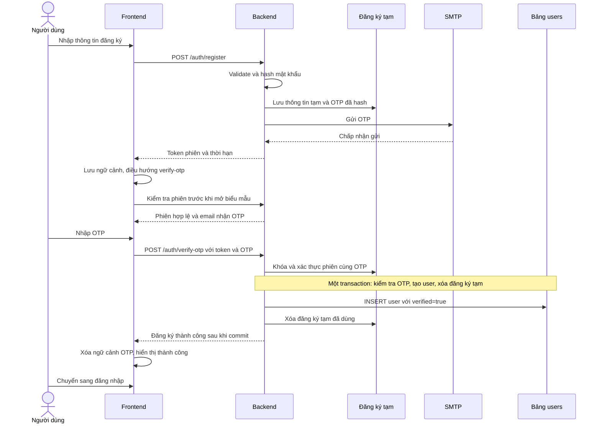

# Cập nhật luồng đăng ký tài khoản sau xác thực OTP

Ngày cập nhật: 23/10/2026. Trạng thái: đặc tả để triển khai; mã nguồn hiện tại chưa áp dụng luồng mới.

## 1. Yêu cầu nghiệp vụ

Luồng đăng ký tài khoản chủ thể bắt buộc theo thứ tự:

1. Người dùng nhập và gửi thông tin đăng ký hợp lệ.
2. Người dùng nhập OTP gửi tới email đã đăng ký.
3. Backend xác thực OTP thành công, sau đó mới thêm tài khoản vào bảng `users`.

Trước bước 3, không tồn tại tài khoản mới trong `users`, kể cả bản ghi có `verified=false`. Backend được lưu **yêu cầu đăng ký tạm** trong bảng riêng để phục vụ OTP; đây không phải tài khoản và không được dùng đăng nhập, phân quyền hay tạo hồ sơ sản phẩm.

Chỉ được mở biểu mẫu `/verify-otp` khi có phiên đăng ký tạm hợp lệ được backend xác nhận. Thiếu thông tin đăng ký hoặc phiên không hợp lệ thì chuyển về `/register` bằng điều hướng thay thế lịch sử.

Phạm vi tài liệu: đăng ký công khai của chủ thể. Không thay đổi cách quản trị viên tạo tài khoản, đăng nhập, quên mật khẩu hoặc đổi mật khẩu.

## 2. Kết quả kiểm tra luồng hiện tại

| Vị trí | Hành vi hiện tại | Điểm cần thay đổi |
| --- | --- | --- |
| [AuthService.register](../../../apps/be/src/services/auth.service.ts) | Gọi `createRegistrant` trước khi tạo/gửi OTP. | Chuyển sang lưu đăng ký tạm; chưa tạo user. |
| [AuthRepository.createRegistrant](../../../apps/be/src/repositories/auth.repository.ts) | Chèn `users` với `role=REGISTRANT`, `verified=false`. | Chỉ tạo user sau khi OTP hợp lệ, với `verified=true`. |
| [AuthRepository.consumeOtp](../../../apps/be/src/repositories/auth.repository.ts) | Nhánh `REGISTER` chỉ cập nhật user đã tồn tại thành `verified=true`. | Kiểm tra phiên, xác thực OTP và tạo user trong cùng transaction. |
| [AuthService.login](../../../apps/be/src/services/auth.service.ts) | Từ chối user chưa xác thực hoặc bị khóa. | Giữ chốt này; bản ghi tồn tại sớm hiện chưa đồng nghĩa đăng nhập được. |
| [RegisterPage](../../../apps/web/src/pages/auth/RegisterPage.tsx) | Ghi email vào sessionStorage trước khi API đăng ký thành công. | Chỉ lưu ngữ cảnh OTP sau phản hồi đăng ký thành công. |
| [pending-email](../../../apps/web/src/pages/auth/pending-email.ts) | Chỉ lưu email, không chứng minh đã gửi thông tin đăng ký. | Lưu ngữ cảnh phiên do backend cấp. |
| [Route verify OTP](../../../apps/web/src/routes/_auth.verify-otp.tsx) | Chưa có `beforeLoad` kiểm tra đăng ký tạm. | Chặn trước khi hiển thị biểu mẫu. |
| [VerifyOtpPage](../../../apps/web/src/pages/auth/VerifyOtpPage.tsx) | Cho sửa email và gửi lại mã chỉ bằng email. | Ràng buộc với phiên đăng ký; email chỉ đọc. |

Hệ quả hiện tại: ngay cả khi gửi mail thất bại, user chưa xác thực vẫn có thể nằm trong database và giữ email qua ràng buộc unique. Đăng ký lại email đó có thể nhận lỗi trùng email.

## 3. Luồng mới

### 3.1. Gửi thông tin đăng ký

- Giữ các trường `fullName`, `email`, `password`, `phone` tùy chọn; chuẩn hóa và kiểm tra bằng quy tắc hiện có. Mật khẩu tối thiểu 8 ký tự, tối đa 72 ký tự và không vượt 72 byte UTF-8.
- Backend kiểm tra email đã tồn tại trong `users`. Không cho ghi đè mật khẩu, thông tin hoặc trạng thái của tài khoản hiện có.
- Backend lưu snapshot thông tin đã validate cùng mật khẩu bcrypt vào đăng ký tạm, tạo OTP 6 chữ số và gửi email. Không gọi `prisma.user.create` tại bước này.
- Chỉ trả phiên thành công khi SMTP chấp nhận gửi. Nếu gửi lỗi: trả lỗi, giữ người dùng ở `/register`, không cấp ngữ cảnh OTP mới; bản ghi tạm phải bị xóa hoặc hết hạn và không được coi là phiên gửi thành công.
- Frontend chỉ ghi ngữ cảnh và chuyển trang sau phản hồi thành công. Khi bắt đầu gửi một đăng ký mới, xóa ngữ cảnh cũ để lỗi của lần mới không mở lại lần trước.
- Nút gửi thông tin dùng nhãn **Gửi mã xác thực**, chưa thông báo đã tạo tài khoản.

### 3.2. Điều kiện vào màn hình OTP

Ngữ cảnh trình duyệt gồm `registrationToken`, email và hạn phiên do backend trả về. Không lưu mật khẩu hoặc password hash vào sessionStorage/localStorage, URL, router state hay log. Xóa giá trị mật khẩu khỏi form sau khi gửi thành công.

Trong `beforeLoad` của route `/verify-otp`:

1. Kiểm tra ngữ cảnh có đủ trường và còn hạn. Chỉ có `ocop.pendingEmail` từ luồng cũ không đủ điều kiện.
2. Gọi backend kiểm tra token để xác nhận đăng ký tạm thực sự tồn tại. Email hiển thị lấy từ phản hồi backend, không tin dữ liệu người dùng sửa trong storage.
3. Thiếu, hỏng, hết hạn, đã dùng hoặc phiên bị khóa: xóa ngữ cảnh và `redirect` tới `/register` với `replace=true`. Không hiển thị thoáng qua biểu mẫu OTP.
4. Backend không phản hồi do mạng hoặc lỗi hệ thống: không hiển thị biểu mẫu chưa được xác nhận; hiển thị lỗi và lựa chọn thử lại hoặc quay lại đăng ký.

Refresh được tiếp tục nếu phiên vẫn hợp lệ. Đóng tab, xóa storage hoặc không thể lưu ngữ cảnh thì phải quay lại đăng ký. Gõ URL trực tiếp, dùng bookmark, Back/Forward hoặc bấm liên kết từ trang đăng nhập đều chịu cùng guard. Phiên đăng nhập có sẵn tiếp tục theo guard `_auth` hiện tại.

Email ở màn hình OTP là chỉ đọc. Muốn sửa email/thông tin, người dùng chọn **Quay lại đăng ký**; frontend xóa ngữ cảnh hiện tại và bắt đầu yêu cầu mới. Các liên kết OTP ở `LoginPage` và `RegisterPage` chỉ mở phiên hợp lệ; trường hợp còn lại đưa tới `/register`.

Guard chỉ điều khiển trải nghiệm. Backend phải kiểm tra đầy đủ phiên và OTP trong mọi request, kể cả gọi API trực tiếp.

### 3.3. Xác thực và tạo tài khoản

Backend tìm đăng ký tạm theo token đã hash và khóa bản ghi trong transaction. Kiểm tra hạn phiên, hạn OTP, số lần nhập sai, trạng thái gửi và OTP thuộc đúng phiên.

- OTP sai: tăng bộ đếm, commit bộ đếm rồi trả lỗi; không tạo user. Không để exception rollback làm mất lần nhập sai. Ngay lần sai thứ 5, trả `410` để frontend xóa ngữ cảnh và chuyển `/register`.
- OTP hết hạn/phiên hết hạn/đã dùng/vượt giới hạn: từ chối; không tạo user.
- OTP đúng: kiểm tra lại email unique, tạo user từ snapshot backend với `role=REGISTRANT`, `verified=true`, `isActive=true`; xóa đăng ký tạm trong cùng transaction.
- Chỉ báo thành công khi transaction commit. Lỗi tạo user phải rollback toàn bộ; OTP đúng không bị tiêu thụ riêng trước khi tạo user thành công.
- Hai request xác thực đồng thời chỉ có một request tạo user thành công. Replay token/OTP không tạo thêm user. Hai phiên dùng cùng email vẫn bị chặn bởi unique constraint của `users.email`.

Sau thành công, frontend xóa ngữ cảnh và OTP, hiển thị **Đăng ký thành công** cùng nút tới `/login`. Không tự cấp JWT đăng nhập. Nếu phản hồi xác thực bị mất sau khi commit, người dùng vẫn có thể đăng nhập; gửi lại OTP không tạo tài khoản thứ hai.

### 3.4. Gửi lại mã và thời hạn

Giữ thời hạn OTP **5 phút**, tối đa **5 lần nhập sai** và các throttle hiện có. Nút gửi lại chờ ít nhất **60 giây**; backend cũng phải kiểm tra khoảng chờ, không chỉ dựa vào bộ đếm frontend.

Thời hạn đăng ký tạm đề xuất cho lần triển khai này: **15 phút từ khi tạo**, độc lập với hạn OTP. Đọc trạng thái hoặc gửi lại không kéo dài hạn phiên. OTP gửi lại hết hạn tại thời điểm sớm hơn giữa `now + 5 phút` và hạn phiên.

Gửi lại yêu cầu token của chính phiên, giữ nguyên thông tin/mật khẩu đã hash và thay mã cũ bằng mã mới. Không tạo user; không đổi email; không xóa bộ đếm nhập sai để né giới hạn. Việc thay mã và xác thực phải dùng cùng cơ chế khóa phiên để tránh hai mã được tiêu thụ đồng thời.

OTP hết hạn nhưng phiên còn hạn thì được gửi lại. Hết 5 lần sai hoặc phiên hết hạn thì quay lại nhập thông tin đăng ký. Gửi SMTP lỗi phải trả trạng thái lỗi, không thông báo đã gửi thành công và không tạo user. Mã cũ bị vô hiệu ngay khi backend phát hành mã thay thế; lỗi SMTP không phục hồi mã cũ. Người dùng được thử gửi lại theo giới hạn backend nếu phiên còn hợp lệ.

## 4. Lưu trữ và hợp đồng API đề xuất

### 4.1. Dữ liệu đăng ký tạm

Thêm `PendingRegistration` ánh xạ bảng `pending_registrations` trong PostgreSQL hiện có. Các trường cần thiết: ID, `tokenHash` unique, email chuẩn hóa, `fullName`, `phone`, `passwordHash`, `otpHash`, `attempts`, `createdAt`, `expiresAt`, `otpExpiresAt`, thời điểm gửi mã thành công và thông tin khoảng chờ gửi lại.

Token phiên dùng giá trị ngẫu nhiên khó đoán tối thiểu 32 byte; chỉ lưu hash ở backend. Mỗi phiên có token và snapshot riêng; gửi đăng ký mới cùng email không ghi đè phiên khác. OTP phải gắn với ID/token phiên và mục đích `REGISTER` trong cả truy vấn lẫn hash; không dùng cách lấy mã mới nhất chỉ theo email như hiện tại.

Đăng ký tạm không có `userId`, không có quyền truy cập ứng dụng. Không thêm bản ghi `users` để thỏa khóa ngoại OTP. Luồng `RESET_PASSWORD` tiếp tục dùng `OtpCode` và user hiện có. Tái sử dụng crypto, bcrypt, repository và transaction hiện có; không cần Redis hoặc dịch vụ lưu phiên mới.

Mọi thao tác phải kiểm tra hết hạn theo giờ backend, kể cả khi bản ghi chưa được dọn khỏi DB. Xóa bản ghi sau xác thực thành công; bản ghi bỏ dở/hết hạn cần được dọn theo quy trình vận hành và không được giữ dữ liệu đăng ký vô thời hạn. Không cần thêm hệ thống lịch chạy trong phạm vi đặc tả luồng này.

### 4.2. API

Các đường dẫn dưới đây có prefix `/api`. Đây là hợp đồng **đề xuất cần triển khai**, chưa phải response hiện tại. Tiếp tục dùng response wrapper `{ statusCode, data, message }` của dự án.

| Endpoint | Request | `data` khi thành công |
| --- | --- | --- |
| `POST /auth/register` | `{ fullName, email, password, phone? }` | `{ registrationToken, email, expiresAt, otpExpiresAt, resendAvailableAt }`; không có user/JWT. |
| `POST /auth/registration-status` mới | `{ registrationToken }` | `{ email, expiresAt, otpExpiresAt, resendAvailableAt }`; chỉ trả cho phiên đang chờ hợp lệ. |
| `POST /auth/verify-otp` | `{ registrationToken, code }` | `{ message: "Registration completed" }` sau khi tạo user và commit. |
| `POST /auth/resend-otp` | `{ registrationToken }` | `{ message, otpExpiresAt, resendAvailableAt }` sau khi SMTP chấp nhận gửi. |

Endpoint kiểm tra trạng thái phục vụ guard trước khi mở màn hình và refresh. Không trả snapshot hồ sơ, mật khẩu hoặc hash. Token không đưa vào query string, URL, log hoặc ví dụ chứa dữ liệu thật. Cập nhật cơ chế che dữ liệu request để cả token phiên và `code` OTP không lọt log.

Quy ước lỗi cho API đăng ký: `400` input/OTP sai hoặc OTP hết hạn; `401` token không hợp lệ/đã dùng; `410` phiên hết hạn hoặc đã khóa; `409` email đã có tài khoản; `429` rate limit/chưa đủ khoảng chờ; `500` gửi mail hoặc thao tác hệ thống thất bại. Các lỗi không được trả thông tin nhạy cảm. Frontend chuyển `/register` khi phiên bị từ chối, giữ màn OTP khi chỉ sai/hết hạn mã nhưng phiên còn hợp lệ.

Tạo DTO riêng cho xác thực đăng ký bằng token. `ResetPasswordDto` hiện kế thừa `VerifyOtpDto` có `email` và `code`; không được thay DTO chung thành token rồi vô tình phá API quên mật khẩu. Luồng reset tiếp tục nhận `{ email, code, newPassword }` và thu hồi token cũ như hiện tại.

## 5. Phạm vi thay đổi khi triển khai

| Khu vực | File/thành phần cần cập nhật |
| --- | --- |
| Database | `apps/be/prisma/schema.prisma`, migration thêm bảng đăng ký tạm. |
| Backend | `auth.controller.ts`, `auth.dto.ts`, `auth.service.ts`, `auth.repository.ts`, nhánh đăng ký trong `otp.service.ts`, hằng số auth; giữ luồng reset độc lập. |
| Bảo vệ log | `apps/be/src/utils/request-meta.ts` và bộ kiểm tra che dữ liệu nhạy cảm của exception filter. |
| Frontend | `RegisterPage.tsx`, `VerifyOtpPage.tsx`, `LoginPage.tsx`, `pending-email.ts`, `_auth.verify-otp.tsx`, constants/auth, constants/api, api/auth và types/auth. Tiếp tục dùng các lớp API và router hiện có. |
| Backend test | `auth.service.spec.ts`, `test/auth.db-spec.ts`, `test/backend.db-spec.ts`, helper/cleanup trong `test/support/db-app.ts`. |
| Frontend test | `test/api-integration.check.mjs` và kiểm tra guard/điều hướng. Cập nhật contract kiểm tra hằng `PENDING_EMAIL_STORAGE_KEY` khi thay ngữ cảnh. |
| API và tài liệu | Kiểm tra OpenAPI/DTO, `types/api-contract.check.ts`, đặc tả tích hợp FE/BE, README và tài liệu backend bị ảnh hưởng sau khi triển khai. Không sửa `routeTree.gen.ts` bằng tay. |

Các test hiện có đang khẳng định user được tạo dù SMTP lỗi và fixture xác thực đăng ký đang tự tạo `verified=false`. Phải thay kỳ vọng này bằng đăng ký tạm, bao gồm kiểm tra schema isolation, hành trình đăng ký và xác thực đồng thời. Dọn test phải xóa cả bản ghi tạm vì chúng không còn được cascade theo user.

### 5.1. Dữ liệu user chưa xác thực từ luồng cũ

Không tự động xác thực hoặc xóa hàng loạt `users.verified=false`. Trước chuyển đổi, kiểm kê riêng `REGISTRANT` chưa xác thực và toàn bộ quan hệ dữ liệu của họ; giữ nguyên admin, giám khảo và user đã xác thực.

Cần migration chuyển từng bản ghi đủ điều kiện sang đăng ký tạm, giữ password hash/thông tin phù hợp và yêu cầu OTP mới trước khi tạo tài khoản theo luồng mới. Bản ghi có liên kết hồ sơ, phân công, phiếu chấm hoặc audit cần xử lý riêng, không xóa để giải phóng email. Không công bố đã hoàn tất chuyển đổi khi email vẫn bị user chưa xác thực cũ giữ mà không có đường xử lý.

Sao lưu, kiểm thử migration/rollback trên bản sao dữ liệu và triển khai đồng bộ FE/BE vì request verify/resend thay đổi. Phiên trình duyệt chỉ có email và mã OTP cũ phải bị từ chối, hướng dẫn đăng ký lại sau khi xử lý bản ghi cũ. Không chạy migration hay thay đổi dữ liệu trong công việc viết tài liệu này.

## 6. Tiêu chí nghiệm thu

| Mã | Tình huống | Kết quả bắt buộc |
| --- | --- | --- |
| DK01 | Mở trực tiếp `/verify-otp` khi chưa gửi đăng ký. | Chuyển `/register` trước khi hiện biểu mẫu; không gửi OTP. |
| DK02 | Storage chỉ có email, token giả, thiếu trường hoặc phiên đã hết hạn/đã dùng. | Backend/guard từ chối, xóa ngữ cảnh, về `/register`. |
| DK03 | Gửi đăng ký hợp lệ, SMTP chấp nhận. | Chỉ có đăng ký tạm, `users` chưa có email mới; sau đó mới mở OTP. |
| DK04 | Input không hợp lệ hoặc SMTP lỗi. | Không có user mới, không có ngữ cảnh thành công; ở lại trang đăng ký. |
| DK05 | Refresh với phiên hợp lệ; mất kết nối khi kiểm tra phiên. | Refresh tiếp tục đúng email; lỗi mạng hiện thử lại, không bỏ qua guard. |
| DK06 | OTP sai, hết hạn, vượt 5 lần hoặc bị replay. | Không tạo user; bộ đếm sai được lưu; hết hạn phiên/khóa thì đăng ký lại. |
| DK07 | OTP đúng và phiên hợp lệ. | Tạo đúng một `REGISTRANT` đã xác thực, hash mật khẩu đúng, xóa đăng ký tạm/ngữ cảnh; sau đó đăng nhập được. |
| DK08 | Hai request verify đồng thời hoặc hai phiên cùng email. | Tối đa một user; một lần tạo thành công; không có cập nhật mật khẩu/hồ sơ từ phiên thua. |
| DK09 | Lỗi DB lúc tạo user. | Không có user dở dang, không mất OTP do commit riêng; không trả thành công. |
| DK10 | Gửi lại OTP hợp lệ, quá sớm hoặc SMTP lỗi. | Không tạo user; giữ snapshot; mã cũ bị thay không dùng được; khoảng chờ enforced ở backend; chỉ báo gửi thành công khi SMTP chấp nhận. |
| DK11 | Sửa email, tự đặt ngữ cảnh hoặc gọi API trực tiếp không qua trang đăng ký. | Không dùng được OTP của phiên/email khác; muốn đổi thông tin phải đăng ký lại. |
| DK12 | Xác thực xong rồi Back, refresh hoặc mất phản hồi thành công. | Không thể tạo lại user; không mở lại phiên đã dùng; tài khoản đã commit vẫn đăng nhập được. |
| DK13 | Đăng ký hai phiên cùng email với mật khẩu khác nhau. | Snapshot và OTP độc lập; OTP phiên A không xác thực phiên B; tạo user chỉ dùng snapshot của phiên được xác thực. |
| DK14 | Hồi quy quên/đổi mật khẩu, đăng nhập, khóa tài khoản và rate limit. | Hành vi hiện có vẫn đúng; không lộ OTP, token, password/hash trong log hoặc response ngoài phần token cấp một lần. |

Nghiệm thu cần kiểm tra trực tiếp DB rằng `users` chưa có email sau bước gửi đăng ký, sau OTP sai và sau gửi lại. Test mock mail không chứng minh thư vào hộp nhận; cần một lượt kiểm tra SMTP thật với cấu hình hợp lệ. Nhánh local `[DEV OTP]` chỉ phục vụ phát triển, không đủ để kết luận gửi email thành công thực tế.
