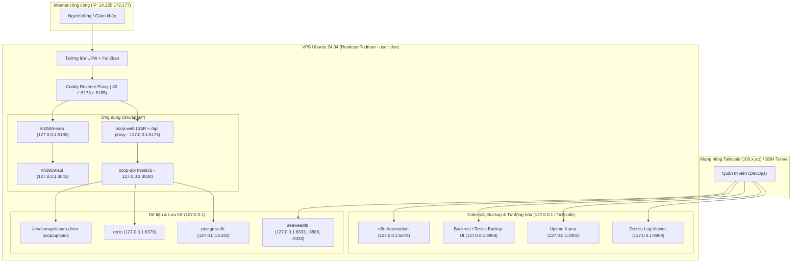

# Thiết kế Hệ thống DevOps, Cache, Bảo mật & Vận hành trên 1 VPS (Rootless Podman)

- **Ngày lập**: 2026-11-22
- **Trạng thái**: Approved
- **Phạm vi**: Dự án `@ocop/api`, `@ocop/web` và hạ tầng dùng chung trên VPS Ubuntu 24.04 (`ocop-cloud`)

---

## 1. Mục tiêu & Lý do (Intent & Why)

Hệ thống chấm điểm OCOP hiện đã có đầy đủ mã nguồn Frontend (`@ocop/web` có SSR), Backend (`@ocop/api` NestJS + Prisma) và cơ sở dữ liệu PostgreSQL chạy trong Rootless Podman trên 1 VPS Ubuntu (`14.225.172.177`, 31 GiB RAM, 197 GB SSD). Tuy nhiên, hệ thống đang thiếu các cấu phần DevOps thiết yếu để vận hành thực tế an toàn:

1. `ocop-web` và `ocop-api` trên VPS đang chạy ở chế độ `NODE_ENV=development` (chạy Vite dev server thay vì bản build SSR `web-server.mjs`), thư mục lưu ảnh/PDF minh chứng (`STORAGE_PATH`) nằm lẫn trong thư mục mã nguồn Git.
2. Chưa có **Redis** để lưu bộ đếm Rate-Limit tập trung và cache các API tra cứu công khai.
3. Chưa có **CI/CD** tự động kiểm tra mã nguồn và triển khai lên VPS.
4. Chưa có **Backup tự động** (mới chỉ có 3 bản dump tĩnh tạo thủ công ngày 22/11) và chưa có cron dọn bảng `pending_auth` mỗi ngày.
5. Chưa có **Monitoring & Logging** trực quan (`Dozzle`, `Uptime Kuma`), công cụ tự động hóa quy trình (`n8n`), **Reverse Proxy** (`Caddy`), và các cổng nội bộ nhạy cảm (như `SeaweedFS :8888, :9333`) đang mở trực tiếp ra IP công cộng `0.0.0.0` mà chưa có tường lửa hay **Tailscale**.

Thiết kế này giải quyết trọn vẹn các khoảng trống trên theo nguyên tắc `/ponytail` (gọn nhẹ nhất, tận dụng tối đa quy ước `/srv/apps/*` và `/srv/storage/*` sẵn có trên VPS, không làm gián đoạn các dịch vụ đang chạy như `postgres-db`, `seaweedfs`, `kh2959-dashboard`).

---

## 2. Goals, Non-Goals & Anti-Goals

### Goals (Mục tiêu cần đạt)
- **Chuẩn hóa Production cho OCOP trên Podman**:
  - Chuyển `ocop-api` và `ocop-web` trên VPS sang `NODE_ENV=production`, chạy Node SSR + `/api` proxy (`web-server.mjs`).
  - Trỏ `DATABASE_URL` của `ocop-api` trên VPS về **`chamdiemocop_prod`** (tách biệt hoàn toàn với `chamdiemocop_dev` dùng cho `pnpm dev:cloud` ở máy phát triển), đồng thời chạy `prisma migrate deploy` trên cả `chamdiemocop_prod` và `chamdiemocop_dev` để đồng bộ lên migration mới nhất (`0022_query_optimization_indexes`).
  - Tách `STORAGE_PATH` ra `/srv/storage/cham-diem-ocop/uploads` (di chuyển an toàn 10 file minh chứng hiện có trong `apps/be/storage` khớp 1-1 với 10 bản ghi `attachments` trong `chamdiemocop_prod`).
- **Dựng Redis & tích hợp vào `@ocop/api`**:
  - Hạ tầng: Container `redis:7-alpine` tại `/srv/apps/redis`, lưu dữ liệu tại `/srv/storage/redis`, chỉ lắng nghe ở `127.0.0.1:6379`.
  - Ứng dụng (`apps/be`): Hỗ trợ `REDIS_URL` (tùy chọn). Khi có `REDIS_URL`, lưu bộ đếm `@nestjs/throttler` và cache ngắn hạn (`TTL 60s`) cho các API đọc công khai (`GET /api/products`, `GET /api/products/:id`, `GET /api/categories`, `GET /api/localities`), tự động xóa cache (invalidate) khi có thao tác duyệt, chấm điểm, công bố, mở lại hồ sơ hoặc sửa danh mục; bổ sung kiểm tra Redis vào `GET /api/system/health/ready`.
- **CI/CD tự động qua GitHub Actions**:
  - **CI**: Chạy `pnpm typecheck`, `lint:check`, unit tests BE/FE, các script check SSR/router/API boundary và `pnpm build`.
  - **CD**: Khi nhánh `main` pass CI, SSH vào VPS cập nhật code, chạy `prisma migrate deploy`, build production và khởi động lại `ocop-api`, `ocop-web`.
- **Trung tâm vận hành `/srv/apps/ops`**:
  - **Caddy**: Reverse proxy cổng vào theo IP (sẵn sàng bật HTTPS bằng 1 dòng cấu hình khi có tên miền).
  - **Dozzle**: Xem và lọc log thời gian thực của toàn bộ container Podman qua trình duyệt.
  - **Uptime Kuma**: Giám sát `/api/system/health/ready`, Postgres, Redis, SeaweedFS, KH2959 và gửi cảnh báo.
  - **Backrest (Restic Web UI) + Kịch bản bảo trì đêm**: Mỗi đêm lúc `02:00` tự động xóa `pending_auth` hết hạn, chạy `pg_dump -Fc` (`chamdiemocop_prod`, `chamdiemocop_dev`, `kh2959`), và đưa cả bản dump DB lẫn thư mục file minh chứng vào kho **Restic** có mã hóa, chống trùng lặp, giữ lịch sử 14 ngày.
  - **n8n**: Hệ thống workflow automation phục vụ gửi thông báo Zalo/Telegram/Google Sheets.
- **Bảo mật nhiều lớp (Phương án 3B)**:
  - Khóa toàn bộ cổng dịch vụ nội bộ và trang quản trị (`postgres`, `redis`, `seaweedfs`, `ocop-api`, `kh2959-api`, `dozzle`, `backrest`, `n8n`, `uptime-kuma`) về `127.0.0.1` (hoặc IP Tailscale).
  - Cài đặt **Tailscale** trên VPS để quản trị viên truy cập riêng tư các trang điều khiển mà không cần mở cổng ra internet.
  - Bật tường lửa **UFW** và **Fail2ban** (bảo vệ SSH `:22` và XRDP `:3389`).
  - Giới hạn dung lượng log container (`max-size: 10m`, `max-file: 3`).

### Non-Goals (Không nằm trong phạm vi)
- Không dựng Kubernetes, Docker Swarm, PgBouncer hay Redis Cluster.
- Không tự dựng Mail Server (Postfix) trên VPS; việc gửi OTP email sử dụng cấu hình `SMTP_*` có sẵn trong `MailService` (dùng Gmail App Password trước, chuyển sang Brevo/SES khi có tên miền).
- Không cấp chứng chỉ SSL Let's Encrypt cho tới khi có tên miền trỏ về VPS.

### Anti-Goals (Điều tuyệt đối tránh)
- Không làm mất dữ liệu hoặc gây gián đoạn lâu cho `postgres-db`, `seaweedfs` và `kh2959-dashboard` đang chạy trên VPS.
- Không mở các trang quản trị không mật khẩu (`SeaweedFS Filer :8888`, `Dozzle`, `Backrest`) ra `0.0.0.0`.
- Không làm hỏng lệnh `pnpm dev` và `pnpm --filter @ocop/api test` ở máy local khi máy local không cài Redis (`REDIS_URL` để trống phải tự động fallback về bộ nhớ RAM).

---

## 3. Các phương án đã cân nhắc (Approaches)

| Phương án | Mô tả | Đánh đổi (Trade-offs) | Quyết định |
| :--- | :--- | :--- | :--- |
| **Phương án 1 (Đã chọn)** | **Kiến trúc mô-đun theo chuẩn `/srv/apps/*` và `/srv/storage/*` của VPS**: Tách riêng `/srv/apps/redis`, `/srv/apps/ops` (`caddy`, `dozzle`, `uptime-kuma`, `backrest`, `n8n`), giữ nguyên `/srv/apps/postgres` & `/srv/apps/seaweedfs`, nâng cấp `/srv/apps/cham-diem-ocop` lên bản Production; lưu bản mẫu cấu hình trong repo tại `deploy/podman/`. | Tách biệt rõ dịch vụ nền tảng và từng ứng dụng; khi deploy hay khởi động lại OCOP không làm sập Redis, Monitoring hay KH2959. | **Chọn** |
| **Phương án 2** | **Gom toàn bộ vào 1 file `compose.yaml` duy nhất trong dự án OCOP** | Làm vỡ cấu trúc `/srv/apps/*` hiện có của VPS; dịch vụ dùng chung cho cả server bị phụ thuộc vào vòng đời của riêng dự án OCOP. | Loại |
| **Phương án 3** | **Đóng gói Docker Image đẩy lên GHCR Registry, xóa mã nguồn trên VPS** | Chuẩn cho hệ thống nhiều máy chủ, nhưng thêm độ phức tạp quản lý Registry Token và lệch với cách `kh2959-dashboard` đang vận hành trên cùng VPS. | Loại (giữ cho giai đoạn đa server) |

---

## 4. Kiến trúc Chi tiết & Sơ đồ Luồng



### 4.1. Quy hoạch Cổng (Port Binding) và Thư mục trên VPS

Toàn bộ dịch vụ nội bộ chỉ bind vào `127.0.0.1` (người ngoài không thể truy cập trực tiếp; quản trị viên truy cập qua IP **Tailscale** với `tailscale serve` / subnet hoặc SSH port-forward):

| Dịch vụ | Thư mục Compose | Thư mục Dữ liệu (`/srv/storage/*`) | Cổng lắng nghe | Ai được truy cập |
| :--- | :--- | :--- | :--- | :--- |
| **Caddy** | `/srv/apps/ops` | `/srv/storage/ops/caddy` | `0.0.0.0:80` (và proxy ứng dụng) | Công cộng (Web) |
| **ocop-web** | `/srv/apps/cham-diem-ocop` | — (đọc `apps/web/dist`) | `0.0.0.0:5173` (hoặc qua Caddy `:80`) | Công cộng |
| **ocop-api** | `/srv/apps/cham-diem-ocop` | `/srv/storage/cham-diem-ocop/uploads` | `127.0.0.1:3030` | Chỉ `ocop-web`, `n8n`, `kuma` nội bộ |
| **postgres-db** | `/srv/apps/postgres` | `/srv/storage/postgres/data` | `127.0.0.1:5432` | Nội bộ VPS & SSH Tunnel |
| **redis** | `/srv/apps/redis` | `/srv/storage/redis` | `127.0.0.1:6379` | Nội bộ VPS (`ocop-api`, `n8n`) |
| **seaweedfs** | `/srv/apps/seaweedfs` | `/srv/storage/seaweedfs` | `127.0.0.1:8333, 8888, 9333` | Nội bộ VPS & Tailscale |
| **dozzle** | `/srv/apps/ops` | Podman socket (`:ro`) | `127.0.0.1:9999` | Quản trị viên (qua Tailscale / SSH) |
| **uptime-kuma** | `/srv/apps/ops` | `/srv/storage/ops/uptime-kuma` | `127.0.0.1:3001` | Quản trị viên (qua Tailscale / SSH) |
| **backrest** | `/srv/apps/ops` | `/srv/storage/backups` | `127.0.0.1:9898` | Quản trị viên (qua Tailscale / SSH) |
| **n8n** | `/srv/apps/ops` | `/srv/storage/ops/n8n` | `127.0.0.1:5678` | Quản trị viên (qua Tailscale / SSH) |

*(Các quyết định kỹ thuật đã chốt bởi Builder [Builder's Calls]:*
1. *Giữ cổng `5173` cho `ocop-web` và `5185` cho `kh2959-web` hoạt động song song với Caddy cổng `:80` trong giai đoạn dùng IP để các đường link cũ `http://14.225.172.177:5173` không bị đứt đột ngột, đồng thời khóa `ocop-api :3030` và `kh2959-api :3045` về `127.0.0.1` vì mọi request `/api` từ trình duyệt đều đi qua proxy `web-server.mjs`.*
2. *Gom toàn bộ các tác vụ cần quyền `root`/`sudo` trên VPS (hạ `sysctl net.ipv4.ip_unprivileged_port_start=80` để Rootless Podman mở được cổng `:80`, cài đặt `Tailscale`, bật tường lửa `UFW` và `Fail2ban`) vào một kịch bản duy nhất `deploy/podman/sudo-bootstrap.sh` để quản trị viên chỉ cần nhập mật khẩu `sudo` đúng 1 lần.*
3. *Cấu hình giới hạn dung lượng log `logging: { driver: "json-file", options: { "max-size": "10m", "max-file": "3" } }` cho toàn bộ dịch vụ trong các file `compose.yaml` để chống tràn ổ cứng).*

### 4.2. Thiết kế tích hợp Redis vào `@ocop/api` (`apps/be`)

1. **Thư viện sử dụng (Đã được người dùng phê duyệt)**: Dùng gói **`ioredis`** (`^5.6.0`, giấy phép MIT) trong `apps/be/package.json` để xây dựng `RedisService` tại `apps/be/src/services/redis.service.ts`. Cấu hình `lazyConnect: true`, `maxRetriesPerRequest: 1`, `enableOfflineQueue: false` để không bao giờ làm treo HTTP request nếu Redis đang khởi động lại.
2. **Cấu hình biến môi trường (`apps/be/src/config/env.ts` & `.env.example`)**:
   - Thêm biến tùy chọn `REDIS_URL` (ví dụ `redis://127.0.0.1:6379/0`).
   - Nếu `REDIS_URL` không đặt hoặc rỗng: `RedisService` hoạt động ở chế độ no-op/in-memory fallback để không ảnh hưởng tới `pnpm dev` và toàn bộ unit test hiện có.
3. **Ba chức năng của `RedisService` trong `@ocop/api`**:
   - **Rate-Limit Storage (`ThrottlerStorage`)**: Cung cấp custom `RedisThrottlerStorage` cài đặt interface `ThrottlerStorage` của `@nestjs/throttler` (dùng lệnh `INCR` + `PEXPIRE` nguyên tử bằng Lua script hoặc pipeline trên Redis, tự động fallback về bộ nhớ RAM nếu Redis ngắt kết nối để không làm sập request của người dùng).
   - **Public Read Cache & Invalidation**:
     - Cache kết quả JSON (TTL `60 giây`) cho các truy vấn công khai đọc nhiều:
       - `CategoriesService.list()` (`cache key: ocop:cache:v1:categories`)
       - `LocalitiesService.list()` (`cache key: ocop:cache:v1:localities`)
       - `ProductsService.listPublic(query)` và `ProductsService.getPublicDetail(id)` (`cache key: ocop:cache:v1:public-products:*`)
     - **Chủ động xóa cache (`invalidatePrefix('ocop:cache:v1:...')`)** ngay khi có thay đổi:
       - Khi sửa danh mục/địa bàn (`AdminCatalogsService`, `LocalitiesService`) → xóa `ocop:cache:v1:categories` / `ocop:cache:v1:localities` và `ocop:cache:v1:public-products:*`.
       - Khi duyệt, trả, chấm điểm, công bố, mở lại hoặc sửa hồ sơ sản phẩm (`AdminProductsService`, `AdminScoringService`, `JudgeService`, `MyProductsService`) → xóa `ocop:cache:v1:public-products:*`.
   - **Health Check (`HealthService.ready()`)**:
     - Nếu `REDIS_URL` được cấu hình, `GET /api/system/health/ready` kiểm tra cả PostgreSQL (`SELECT 1`) và Redis (`PING` với timeout `1000ms`).

### 4.3. Thiết kế Backup tự động (Restic + Backrest + Nightly Maintenance)

1. **Kịch bản chuẩn bị dữ liệu mỗi đêm (`/srv/apps/ops/backup-maintenance.sh`)**:
   - Chạy tự động lúc `02:00` sáng hằng ngày qua `systemd --user` timer (`ocop-maintenance.timer`):
     1. **Dọn bảng `pending_auth` hết hạn** trên cả `chamdiemocop_prod` và `chamdiemocop_dev`:
        ```sql
        DELETE FROM "pending_auth" WHERE "expiresAt" <= NOW();
        ```
     2. **Xuất bản sao nhất quán của PostgreSQL (`pg_dump -Fc`)** vào `/srv/storage/backups/staging/postgres/`:
        - `chamdiemocop_prod.dump`
        - `chamdiemocop_dev.dump`
        - `kh2959.dump`
2. **Kho lưu trữ Restic & Giao diện Backrest (`127.0.0.1:9898`)**:
   - Backrest quản lý kho Restic đặt tại `/srv/storage/backups/restic-repo` (và có thể thêm repo thứ 2 trỏ vào SeaweedFS S3 `http://127.0.0.1:8333` hoặc Cloud bên ngoài).
   - Nguồn dữ liệu đưa vào Restic mỗi đêm (`02:15` sáng):
     - `/srv/storage/backups/staging/postgres` (bản dump DB mới nhất)
     - `/srv/storage/cham-diem-ocop/uploads` (toàn bộ ảnh và PDF minh chứng OCOP)
     - `/srv/storage/ops/n8n` (các luồng tự động hóa n8n)
   - Chính sách giữ bản sao (Retention Policy): Giữ **14 ngày gần nhất**, **4 tuần gần nhất**, **3 tháng gần nhất**, tự động `prune` chống đầy đĩa.

### 4.4. Thiết kế CI/CD (`.github/workflows/ci-cd.yml`)

- **Job `verify` (Chạy trên mọi Push và Pull Request)**:
  1. Cài đặt Node 24 & `pnpm`.
  2. `pnpm install --frozen-lockfile`
  3. `pnpm --filter @ocop/api prisma generate`
  4. `pnpm typecheck`
  5. `pnpm --filter @ocop/api lint:check`
  6. `pnpm --filter @ocop/api test -- --runInBand`
  7. `pnpm --filter @ocop/web format:check`
  8. `pnpm build`
  9. Chạy các bài kiểm tra kiến trúc FE & SSR (`node --experimental-transform-types --import ./apps/web/test/register-typescript.mjs --test apps/web/test/*.test.ts scripts/dev-cloud.test.mjs`, `router.check.mjs`, `ssr.check.mjs`).
- **Job `deploy` (Chỉ chạy khi push vào nhánh `main` và khi đã khai báo GitHub Secret `VPS_SSH_KEY`)**:
  - Kết nối SSH vào VPS, cập nhật code tại `/home/dev/Desktop/cham-diem-ocop`, kích hoạt `/srv/apps/cham-diem-ocop/deploy.sh` (đã nâng cấp để chạy `prisma migrate deploy`, build cả `@ocop/api` lẫn `@ocop/web` SSR, khởi động lại container và gọi kiểm tra `curl -fsS http://127.0.0.1:3030/api/system/health/ready`).

---

## 5. Architecture Decision Records (ADRs — theo `/grill-with-docs`)

### ADR-001: Giữ mô hình Mô-đun Rootless Podman theo quy ước `/srv/apps/*` trên 1 VPS
- **Bối cảnh**: VPS đang chạy Rootless Podman `4.9.3` dưới user `dev` (`Linger=yes`, `podman-restart.service` enabled) với nhiều hệ thống (`postgres`, `seaweedfs`, `kh2959-dashboard`, `cham-diem-ocop`).
- **Quyết định**: Tách riêng từng nhóm dịch vụ vào `/srv/apps/redis` và `/srv/apps/ops`, nâng cấp `/srv/apps/cham-diem-ocop` lên chế độ Production thay vì gom tất cả vào 1 file compose duy nhất.
- **Hệ quả**: Khởi động lại hay cập nhật dự án OCOP không làm gián đoạn Redis, hệ thống giám sát hay dự án KH2959.

### ADR-002: Sử dụng Redis cho Rate-Limit và Public Cache với Graceful Fallback
- **Bối cảnh**: `@ocop/api` cần Redis để lưu bộ đếm Rate-Limit và giảm tải truy vấn sản phẩm/danh mục công khai cho SSR, nhưng lập trình viên chạy máy local hoặc CI có thể không bật Redis.
- **Quyết định**: Kết nối Redis qua biến tùy chọn `REDIS_URL`. Khi không có `REDIS_URL` hoặc khi Redis mất kết nối tạm thời, hệ thống tự động fallback về bộ nhớ RAM và không làm gãy request. Mọi thao tác thay đổi trạng thái hồ sơ hoặc danh mục đều chủ động xóa cache liên quan.
- **Hệ quả**: Không bao giờ trả dữ liệu cũ sau khi Công bố/Mở lại hồ sơ; local dev và test vẫn chạy bằng 1 lệnh `pnpm dev` không phụ thuộc bắt buộc vào Redis.

### ADR-003: Sao lưu chống trùng lặp bằng Restic + Backrest kèm tách `STORAGE_PATH`
- **Bối cảnh**: Ảnh và PDF minh chứng hồ sơ OCOP hiện nằm trong thư mục git (`apps/be/storage`) và chưa có sao lưu tự động.
- **Quyết định**: Chuyển `STORAGE_PATH` ra `/srv/storage/cham-diem-ocop/uploads`; dùng `systemd timer` chạy `pg_dump` và dọn `pending_auth` mỗi đêm, sau đó dùng **Restic + giao diện web Backrest** để sao lưu chống trùng lặp và mã hóa.
- **Hệ quả**: Tách bạch tuyệt đối dữ liệu người dùng khỏi thư mục code; tiết kiệm ~90% dung lượng ổ cứng khi sao lưu file ảnh/PDF nhiều ngày; người mới có thể xem lịch sử và khôi phục bản sao lưu ngay trên trình duyệt.

### ADR-004: Bảo mật mạng theo mô hình Zero-Trust Nội bộ (`127.0.0.1` + Tailscale + UFW + Fail2ban)
- **Bối cảnh**: Chưa có tên miền để đứng sau Cloudflare, trong khi nhiều cổng nội bộ (`SeaweedFS :8888/:9333`, `API :3030/:3045`) đang mở ra `0.0.0.0`.
- **Quyết định**: Khóa toàn bộ cổng dữ liệu, API nội bộ và trang quản trị (`Dozzle`, `Backrest`, `n8n`, `Uptime Kuma`, `SeaweedFS`) về `127.0.0.1`; cài đặt **Tailscale** cho truy cập quản trị từ xa; bật **UFW** và **Fail2ban** trên VPS.
- **Hệ quả**: Bề mặt tấn công từ Internet công cộng chỉ còn cổng Web và SSH được bảo vệ bởi Fail2ban; toàn bộ công cụ quản trị hoàn toàn ẩn khỏi các công cụ quét cổng trên Internet.

---

## 6. Từ điển Thuật ngữ DevOps của Hệ thống (DevOps Glossary)

| Thuật ngữ | Giải thích dễ hiểu trong ngữ cảnh dự án OCOP |
| :--- | :--- |
| **Rootless Podman** | Công cụ chạy container dưới quyền tài khoản thường (`dev`) thay vì quyền tối cao (`root`), giúp cô lập an toàn nếu ứng dụng bị tấn công. |
| **SSR (`web-server.mjs`)** | Máy chủ Node của giao diện web giúp trả sẵn nội dung HTML cho trang sản phẩm công khai và chuyển tiếp các yêu cầu `/api/*` sang `ocop-api`. |
| **Reverse Proxy (`Caddy`)** | "Quầy lễ tân" đứng ở cổng chính nhận truy cập từ người dùng và điều hướng vào đúng dịch vụ bên trong, đồng thời tự động gắn ổ khóa HTTPS khi có tên miền. |
| **Cache Invalidation** | Cơ chế tự động xóa bản lưu tạm trong Redis ngay khi Chủ trì/Quản trị duyệt hoặc công bố kết quả mới, đảm bảo người dùng luôn thấy điểm và số sao mới nhất. |
| **Deduplication (`Restic`)** | Kỹ thuật sao lưu thông minh chỉ lưu thêm những phần dữ liệu/file ảnh mới thay đổi so với ngày hôm trước, giúp sao lưu mỗi ngày mà không tốn ổ cứng. |
| **Tailscale** | Mạng riêng ảo (VPN dựa trên WireGuard) nối trực tiếp máy tính của bạn với VPS, giúp chỉ mình bạn mở được các trang quản trị (`Dozzle`, `Backrest`, `n8n`). |
| **Fail2ban** | Phần mềm canh cửa tự động cấm địa chỉ IP của kẻ xấu nếu phát hiện họ thử đăng nhập sai mật khẩu SSH hoặc Remote Desktop nhiều lần. |
